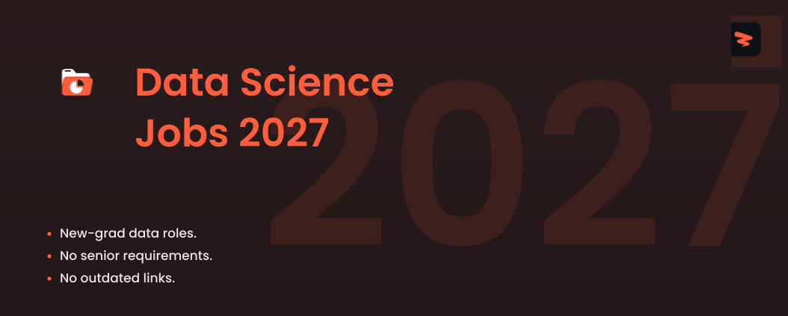

<!-- Cover -->

# Data Science Jobs 2027

🚀 Data science, analytics, and ML jobs for new graduates, updated every 10 minutes.

  
  
  
  

---

## **Website & Autofill Extension**

Explore Zapply's website and check out:

- Our Chrome extension, which autofills job applications in seconds.
- A dedicated job board featuring the latest openings across various roles.
- User accounts with multiple profiles for different resume types and roles.
- Job application tracking with streaks and commitment awards.

Experience an advanced career journey with us! 🚀

  

## Explore Around

Connect and seek advice from a growing network of fellow students and new grads.

  
  &nbsp;&nbsp;
  

---

 

<h3>🔬 <strong>Data Scientist</strong></h3>

| Company | Role | Location | Posted | Visa | **Apply** |
|---------|------|----------|--------|------|----------|
| **Marvell** | AI Data Science Intern, MS - Summer 2027 | Santa Clara, CA | 16m | ✅ Sponsor |  |
| **Capital One** | Manager, Data Science - US Card - Marketing | McLean, VA | 27m | ✅ Sponsor |  |
| **Capital One** | Manager, Data Science - AI Foundations | New York, NY | 27m | ✅ Sponsor |  |
| **Johnson & Johnson** | Quality Data Science Co-Op , Summer 2027 | Cincinnati, Ohio, United States... | 2h | ✅ Sponsor |  |
| **Waymo** | 2027 Summer Intern, PhD, Research Scientist, Visual Reasoning | Mountain View, CA, USA | 6h | ✅ Sponsor |  |
| **Cox** | Data Scientist Intern - Summer 2027 (Atlanta, GA) | Atlanta GA | 2d | ✅ Sponsor |  |
| **Zoetis** | Chemistry Data Science Intern - Digital CMC Workflows | Kalamazoo - Downtown Portage Street | 3d | ✅ Sponsor |  |
| **Wash U** | Research Statistician I - Data Scientist - Anesthesiology | Washington University Medical | 3d |  |  |
| **KLA** | Research Scientist Intern - Plasma Light Source Characterization | Ann Arbor, MI | 4d | ✅ Sponsor |  |
| **Ardian** | Data Scientist Intern - February 2027   NYC | New York | 4d |  |  |
| **Duolingo** | Data Scientist, Intern | New York, NY | 4d | ✅ Sponsor |  |
| **Duolingo** | Data Scientist, Intern (PhD) | New York, NY | 4d | ✅ Sponsor |  |
| **Amazon.com Services LLC** | Data Scientist I, PXT Central Science | Arlington, VA | 4d | ✅ Sponsor |  |
| **Dow Jones** | Summer 2027 Internship Program - Marketing Data Science Intern | NYC | 5d | ✅ Sponsor |  |
| **Nike** | Machine Learning Engineer I | Beaverton, Oregon | 5d | ✅ Sponsor |  |
| **Point72** | 2027 Summer Internship - MS/PhD Data Scientist, Proprietary Research | New York, NY | 5d | ✅ Sponsor |  |
| **Capital One** | Manager Data Science - Global Payment Network AI Foundations | Riverwoods, IL | 6d | ✅ Sponsor |  |
| **Baxter International** | Research Scientist I | Round Lake, Illinois | 6d |  |  |
| **Baxter International** | Research Scientist I | Round Lake, Illinois | 6d |  |  |
| **Wells Fargo** | Data Science Associate | CHARLOTTE, NC | 6d | ✅ Sponsor |  |
| **Nissan** | Data Science Intern - Summer 2027 - Smyrna, TN | Smyrna, Tennessee - United... | 1w |  |  |
| **Nissan** | Data Science Intern - Summer 2027 - Franklin, TN | Franklin, Tennessee - United... | 1w |  |  |
| **Symbotic** | Intern- PhD Applied Scientist, Routing | USA Wilmington,  MA - | 1w | ✅ Sponsor |  |
| **AbbVie** | Associate Data Scientist I | North Chicago, IL | 1w | ✅ Sponsor |  |
| **Tencent** | Data Science Intern | California-Palo Alto | 1w | ✅ Sponsor |  |
| **Itron** | Intern - HR AI Data Science (Summer 2027) | TX | 1w | ✅ Sponsor |  |
| **Zoetis** | Summer Intern – Pharmacogenomics Data Science & Genomic Prediction (VMRD) | Kalamazoo - Downtown Portage Street | 1w | ✅ Sponsor |  |
| **Cox** | Data Scientist Co-op | Atlanta GA | 1w | ✅ Sponsor |  |
| **MITRE** | Data Science Intern | McLean, Virginia | 1w |  |  |
| **Perpay** | Super Day - Data Science Internship | Philadelphia, Pennsylvania,... | 1w | ✅ Sponsor |  |
| **IMC Trading** | Machine Learning Engineer Intern - Summer 2027 | New York, United States | 1w | ✅ Sponsor |  |
| **Roblox** | \[2027\] Data Scientist - PhD Intern | San Mateo, CA, United States | 1w | ✅ Sponsor |  |
| **Roblox** | \[2027\] Senior Machine Learning Engineer - PhD Early Career | San Mateo, CA, United States | 1w | ✅ Sponsor |  |
| **Roblox** | \[2027\] Applied Scientist - PhD Intern | San Mateo, CA, United States | 1w | ✅ Sponsor |  |
| **GenBio AI** | Research Scientist Intern, AI Molecular Design | Palo Alto, CA | 1w | ✅ Sponsor |  |
| **Dell Technologies** | Data Science Undergraduate Intern | TX, United States | 1w |  |  |
| **NVIDIA** | Research Scientist, Autonomous Systems and Physical AI Research - PhD New College Grad 2026 | US, CA, Santa Clara | 1w | ✅ Sponsor |  |
| **Bose** | Data Analytics Engineer Co-op | MA Framingham | 1w | ✅ Sponsor |  |
| **Intel** | Data Science and Analytics - PhD Intern | US, Oregon, Hillsboro | 1w | ✅ Sponsor |  |
| **Leidos** | Data Science Intern | Arlington, VA | 1w | ✅ Sponsor |  |
| **JPMorgan Chase** | Finance & T/CIO Chief Data Office - Data Science Associate | New York, NY, United States | 1w | ✅ Sponsor |  |
| **Booz Allen Hamilton** | Data Scientist, Junior | San Diego, CA | 1w | ✅ Sponsor |  |
| **LexisNexis Risk Solutions** | Data Science Intern | Alpharetta, GA | 2w | ✅ Sponsor |  |
| **Adobe** | 2027 Intern - Applied and Research Scientist/Engineer | San Jose | 2w | ✅ Sponsor |  |
| **Figma** | PhD Intern, AI Applied Scientist (2027) | San Francisco, CA • New York, NY | 2w | ✅ Sponsor |  |
| **First Solar** | Data Science Intern – Device Characterization (Spring 2027) | Perrysburg, OH, United States | 2w | ✅ Sponsor |  |
| **General Motors** | 2027 Summer Intern – Machine Learning Engineer, AV/AI Platform | Sunnyvale, California, United... | 2w | ✅ Sponsor |  |
| **Google** | Data Scientist, Research Intern, PhD, Summer 2027 | United States | Date unknown | ✅ Sponsor |  |
| **Google** | Business Data Scientist Intern, PhD, Summer 2027 | United States | Date unknown | ✅ Sponsor |  |
| **ByteDance** | Research Scientist Intern (Distributed NoSQL Database Systems) - 2027 Start (PhD) | Seattle, Washington | Date unknown | ✅ Sponsor |  |
| **ByteDance** | Machine Learning Engineer Intern (E-Commerce Risk Control)- 2027 Start (PhD) | Seattle, Washington | Date unknown | ✅ Sponsor |  |
| **ByteDance** | Machine Learning Engineer Intern (E-Commerce Risk Control)- 2027 Start (PhD) | San Jose, California | Date unknown | ✅ Sponsor |  |
| **Federal Reserve System** | Summer 2027 Intern-Data Science and Business Analytics | Chicago, IL | 2w |  |  |
| **Federal Reserve System** | Summer 2027 Intern- PhD Data Science or Computer Science | Chicago, IL | 2w |  |  |
| **Adobe** | 2027 Intern - Machine Learning Engineer | San Jose | 2w | ✅ Sponsor |  |
| **Johnson & Johnson** | Data Science Co-op | Danvers, Massachusetts, United... | 2w | ✅ Sponsor |  |
| **Pinterest** | Master's Data Science Internship 2027 (USA) | San Francisco, CA, US | 2w | ✅ Sponsor |  |
| **Pinterest** | PhD Data Science Internship 2027 (USA) | San Francisco, CA, US | 2w | ✅ Sponsor |  |
| **Stripe** | PhD Data Scientist, Intern | New York, Seattle, South San... | 2w | ✅ Sponsor |  |
| **Flagship Pioneering** | Terrana: Bioinformatics Co-Op: Computational Biology & Data Science | Cambridge, MA USA | 2w |  |  |
| **Verizon** | Irving V Teamer for a Day: Verizon Data Science Summer 2027 Internship | Irving, Texas | 2w |  |  |
| **Verizon** | Verizon Network and Technology: Data Science Summer 2027 Internship | Irving, Texas | 2w |  |  |
| **Stantec** | Data Science Intern - Infrastructure (Summer 2027) | Orlando, FL, United States | 2w |  |  |
| **Q2** | 2027 Summer Internship - Data Science | Cary, North Carolina | 2w |  |  |
| **Q2** | 2027 Summer Internship - Machine Learning Engineer | Cary, North Carolina | 2w |  |  |
| **Lyft** | Applied Scientist Intern, PhD (Summer 2027) | San Francisco, CA | 3w | ✅ Sponsor |  |
| **Gilead Sciences** | Intern - Research - Data Sciences - AI | United States - California -... | 3w | ✅ Sponsor |  |
| **Gilead Sciences** | Intern - Research - Data Sciences - AI | United States - California -... | 3w | ✅ Sponsor |  |
| **LLNL** | Data Science Institute Graduate Student Intern - Summer 2027 | Livermore, CA | 3w | ✅ Sponsor |  |
| **First Solar** | Data Science Intern (Spring 2027) | Perrysburg, OH, United States | 3w | ✅ Sponsor |  |
| **ICF** | 2027 Summer Intern, Data Scientist (Reston, VA; Denver, CO; Remote) | Reston, VA | 3w |  |  |
| **Red Ventures** | 2027 Launch Program: Data Science Intern | Charlotte, NC | 3w |  |  |
| **Merck & Co.** | 2027 Future Talent Program - Data Science - Intern | USA - Pennsylvania - West Point | 3w | ✅ Sponsor |  |
| **Cisco** | Machine Learning Engineer I (Intern) – United States | San Jose California US | 3w | ✅ Sponsor |  |
| **Cisco** | Machine Learning Engineer II (Intern) – United States | San Jose California US | 3w | ✅ Sponsor |  |
| **Cisco** | Machine Learning Engineer II (Intern) – United States | San Jose, California | 3w | ✅ Sponsor |  |
| **Amgen** | Grad Intern – Data Scientist – Technology, AI & Data (Summer 2027) | United States - Remote | 3w | ✅ Sponsor |  |
| **Waymo** | 2027 Summer Intern, MS/PhD, Machine Learning Engineer - Simulator Realism Evaluation | San Francisco, California,... | 3w | ✅ Sponsor |  |
| **MITRE** | Computer and Data Science Intern | Bellevue, Nebraska | 3w |  |  |
| **Waymo** | 2027 Summer Intern, PhD, Data Science | Mountain View, CA, USA | 3w | ✅ Sponsor |  |
| **Johnson & Johnson** | Commercial Data Science & AI Co-op | Raritan, New Jersey, United... | 3w | ✅ Sponsor |  |
| **Amazon.com Services LLC** | 2027 Data Science Internship - United States, PhD or Masters Student | Seattle, WA | 3w | ✅ Sponsor |  |
| **Epic Games** | Data Science Intern | Cary,North Carolina,United States | 4w | ✅ Sponsor |  |
| **Premier** | Data Science Intern | Charlotte, NC | 4w | ✅ Sponsor |  |
| **GE Aerospace** | SaaS - Flight Analytics Platform - Data Science Co-op - Spring 2027 | Austin | 4w | ✅ Sponsor |  |
| **Viking Global Investors** | Data Science Intern - Summer 2027 | New York, NY | 4w |  |  |
| **Figma** | PhD Intern, Data Science (2027) | San Francisco, CA • New York, NY | 4w | ✅ Sponsor |  |
| **Flagship Pioneering** | Metaphore: Data Science Co-Op | Cambridge, MA USA | 4w |  |  |
| **AutoZone** | AutoZone 2027 Summer Internship – Data Science | Memphis, TN, United States | 4w | ✅ Sponsor |  |
| **MITRE** | Internships in Data Science, Math, Statistics or Operations Research | McLean, Virginia | 4w |  |  |
| **Thomson Reuters** | Applied Scientist Intern | Ann Arbor, California | 1mo | ✅ Sponsor |  |
| **Vanguard** | College to Corporate IT Internship - Data Science (PA) | Malvern, PA | 1mo | ✅ Sponsor |  |
| **Vanguard** | College to Corporate IT Internship - Data Science (NC) | Charlotte, NC | 1mo | ✅ Sponsor |  |
| **Generac** | Data Science Intern - Summer 2027 | Waukesha, WI | 1mo | ✅ Sponsor |  |
| **Amgen** | Undergrad Intern – Machine Learning Engineer – Technology, AI & Data (Summer 2027) | United States - Remote | 1mo | ✅ Sponsor |  |
| **Amgen** | Undergrad Intern – Data Scientist – Technology, AI & Data (Summer 2027) | United States - Remote | 1mo | ✅ Sponsor |  |
| **S&P Global** | Machine Learning Engineer - Summer Intern 2027 | Cambridge, MA | 1mo | ✅ Sponsor |  |
| **Merck & Co.** | 2027 Future Talent Program - Biostatistics and Research and Decision Sciences - Health Economics... | Pennsylvania West Point | 1mo | ✅ Sponsor |  |
| **Nike** | NIKE, Inc. Artificial Intelligence, Data, & Machine Learning Engineering Undergraduate Internship | Beaverton, Oregon | 1mo | ✅ Sponsor |  |
| **AspenTech** | Data Science Intern - Summer 2027 - Bedford, MA | Bedford, Massachusetts | 1mo | ✅ Sponsor |  |

Apply for more jobs at

<h3>📊 <strong>Data Analyst</strong></h3>

| Company | Role | Location | Posted | Visa | **Apply** |
|---------|------|----------|--------|------|----------|
| **Wash U** | Bioinformatics Research Assistant (Part-Time) - Medical Oncology | Washington University Medical | 16m |  |  |
| **Carrier Global** | Data Analytics Intern - Summer | CAI23: Carrier-Indianapolis,... | 16m |  |  |
| **KLA** | Tax & Data Analytics Intern | Ann Arbor, MI | 16m | ✅ Sponsor |  |
| **Dow Jones** | Research Analyst I - Chemical Market Analytics | Houston, TX - OPIS | 26m | ✅ Sponsor |  |
| **Capital One** | Manager, Data Analysis | McLean, VA | 27m |  |  |
| **National Interstate Insurance** | FIS Claims Intern (Spring 2027) | Cincinnati, OH | 1h |  |  |
| **Highmark Health** | Summer 2027 Data Analyst Undergraduate Intern | Pittsburgh PA, 15222, FAP, 5th... | 1h | ✅ Sponsor |  |
| **CVS Health** | Coding Data Quality Auditor | TN Work from home | 3h | ✅ Sponsor |  |
| **Vertex Pharmaceuticals** | Spring 2027 Co-op, Internal Audit | Boston, MA | Date unknown |  |  |
| **Microsoft** | Applied Sciences INTERN | United States | 17h | ✅ Sponsor |  |
| **Together AI** | Research Intern, Frontier Speculative Decoding (Winter 2027) | San Francisco | 3d | ✅ Sponsor |  |
| **Together AI** | Research Intern, Frontier Speculative Decoding (Summer 2027) | San Francisco | 3d | ✅ Sponsor |  |
| **Daimler Truck** | Applied Data & Technology Intern | Portland, OR US | 3d | ✅ Sponsor |  |
| **Accenture Federal Services** | SAP Data Migration Consultant - 100% onsite in St. Louis, MO | St. Louis, MO | 3d |  |  |
| **CACI** | Junior Data Analyst | Florham Park, NJ, US | 3d | ✅ Sponsor |  |
| **Leidos** | Data Engineering & Analytics Intern | Shiloh, IL | 3d | ✅ Sponsor |  |
| **ColdQuanta** | Quantum Physicist (Quantum Computing) | Louisville, Colorado | 3d |  |  |
| **ColdQuanta** | Quantum Physicist (Quantum Computing) | Chicago, Illinois | 3d |  |  |
| **ColdQuanta** | Quantum Physicist (Quantum Computing) | Madison, Wisconsin | 3d |  |  |
| **Emerson Electric** | Data Analyst Co-Op | Marshalltown, IA, United States | 3d | ✅ Sponsor |  |
| **GM Financial** | AVP IT Audit Data Analytics | Arlington, TX, United States | 3d |  |  |
| **Nissan** | Credit Risk Analytics Intern - Summer 2027 - Irving, TX | Irving, Texas - United States... | 4d |  |  |
| **Moderna** | Co-Op, Biopharmaceutical Manufacturing Operations | Norwood, Massachusetts, Drug... | 4d |  |  |
| **Moderna** | Co-Op, Automation, Digital Manufacturing & Controls | Norwood, Massachusetts, Drug... | 4d |  |  |
| **Ashby** | Data Analytics Manager | Remote - US | 4d |  |  |
| **Tower Research Capital** | Quantitative Researcher (Mulitple Openings) | New York, New York | 4d | ✅ Sponsor |  |
| **Vertex Pharmaceuticals** | Spring Co-Op 2027, Commercial Analytics, Market Access | Boston, MA | Date unknown |  |  |
| **Vertex Pharmaceuticals** | Spring Co-Op 2027, In Silico Modeling | Boston, MA | Date unknown |  |  |
| **Amazon.com Services LLC** | Catalog Specialist, Science Annontations | Bellevue, WA | 4d | ✅ Sponsor |  |
| **Wash U** | Data Analyst - Emergency Management Intern (PRN) - Enterprise Physical Operations | Washington University (North | 5d |  |  |
| **Nissan** | Computational Material Science Intern - Spring 2027 - Santa Clara, CA | Santa Clara, California -... | 5d |  |  |
| **Nissan** | People Analytics Intern - Summer 2027 - Franklin, TN | Franklin, Tennessee - United... | 5d |  |  |
| **Dow Jones** | Summer 2027 Internship Program – Research Analyst Intern | Houston, TX - OPIS | 5d | ✅ Sponsor |  |
| **Dow Jones** | Summer 2027 Internship Program – Research Analyst Intern | Houston, TX - OPIS | 5d | ✅ Sponsor |  |
| **Moderna** | Associate I, Quality Control, Raw Materials | Norwood, Massachusetts, Quality | 5d |  |  |
| **ABB** | Data Analytics Intern | New Berlin, Wisconsin, United... | 5d | ✅ Sponsor |  |
| **National Interstate Insurance** | Third-Party Risk & Analytics Intern (Year-Round) | Cincinnati, OH | 5d |  |  |
| **PNC Financial Services** | Portfolio Analytics & Strategy Specialist (Card Fraud Strategy) | Columbus Plaza Main | 5d | ✅ Sponsor |  |
| **MITRE** | Applied Operations Research | Colorado Springs, Colorado | 5d |  |  |
| **Wash U** | Bioinformatics Research Assistant - Pediatrics Newborn Medicine | Washington University Medical | 6d |  |  |
| **Guidehouse** | Emergency Management Strategy and Analytics Consultant | IL Belleville | 6d | ✅ Sponsor |  |
| **Guidehouse** | Emergency Management Strategy and Analytics Consultant | CO, Denver | 6d | ✅ Sponsor |  |
| **University of Texas at Austin** | Biostatistician I | AUSTIN, TX | 6d |  |  |
| **Capital One** | Manager, Data Analysis - People Strategy & Analytics | McLean, VA | 6d | ✅ Sponsor |  |
| **Capital One** | Data Analysis Manager - Analytics & Transformation | McLean, VA | 6d | ✅ Sponsor |  |
| **Nightwing** | Junior Signals Intelligence Officer (SIO) | Sterling, VA | 6d |  |  |
| **Arrowstreet Capital** | Quant Finance Symposium, February 2027 | Boston | 6d |  |  |
| **Datadog** | Research Manager - Post-Training for Agents | New York, New York, USA | 6d | ✅ Sponsor |  |
| **Vertiv** | Data Analytics Intern (Summer 2027) | Delaware, OH, United States | 6d | ✅ Sponsor |  |
| **LLNL** | Protein Bioinformatics - Postdoctoral Researcher | Livermore, CA | 6d | ✅ Sponsor |  |
| **General Motors** | Summer 2027 Intern - Research and Development - Smart Manufacturing Systems | Warren, Michigan, United States... | 1w |  |  |
| **General Motors** | Entry-Level – Researcher, Aftertreatment Catalysis | Warren, Michigan, United States... | 1w |  |  |
| **KLA** | Algorithm Engineering Intern (GPU/CUDA) | Milpitas, CA | 1w | ✅ Sponsor |  |
| **Waymo** | 2027 Summer Intern, MS/PhD, Perception, Model Lifecycle | Mountain View, CA, USA | 1w | ✅ Sponsor |  |
| **Fidelity Investments** | Research Analyst I | Boston, MA | 1w | ✅ Sponsor |  |
| **Western Digital** | Spring Co-op - Recording Electronics Data Analytics & Optimization | Rochester, MN | 1w | ✅ Sponsor |  |
| **1Password** | Data Intern  - Product Analytics - Winter 2027 | Remote (United States  Canada) | 1w |  |  |
| **Fidelity Investments** | Associate, Analytics & Performance Insights | Salt Lake City, UT | 1w | ✅ Sponsor |  |
| **Google** | People Analytics Intern, PhD, Summer 2027 | United States | Date unknown | ✅ Sponsor |  |
| **Amazon.com Services LLC** | Applied Science Manager, Seller Partner Trust and Store Integrity Science - Global Risk... | Seattle, WA | 1w | ✅ Sponsor |  |
| **RELX** | Clinical Analytics Specialist – MD | Texas | 1w | ✅ Sponsor |  |
| **Itron** | Intern - People Analytics (Summer 2027) | WA | 1w | ✅ Sponsor |  |
| **Zoetis** | Non-Clinical and Diagnostics Statistician Intern | Kalamazoo - Downtown Portage Street | 1w | ✅ Sponsor |  |
| **Guidehouse** | Business Analytics Consultant | DC, Washington | 1w | ✅ Sponsor |  |
| **Squarepoint Capital** | Quantitative Researcher, Volatility - Medium-Frequency | New York | 1w |  |  |
| **Amentum** | Identity Intelligence Analyst - Junior | VA-Charlottesville | 1w |  |  |
| **Highmark Health** | ETDP Associate - Data Analytics | Pittsburgh PA, 15222, PAP, Penn... | 1w | ✅ Sponsor |  |
| **Applied Materials** | 2027 Data Analytics & Business Operations Spring Co-Op or Summer Intern- Bachelor's/Master's... | Austin,TX | 1w | ✅ Sponsor |  |
| **GE Healthcare** | Summer 2027 Data Analytics Intern | Salt Lake City | 1w |  |  |
| **Caterpillar** | Marketing Technology & Data Consultant | Irving Texas | 1w | ✅ Sponsor |  |
| **Caterpillar** | Marketing Technology & Data Consultant | Irving Texas | 1w | ✅ Sponsor |  |
| **UPS** | Finance & Accounting Special Projects Data Analytics Supervisor   20E | ATLANTA, Georgia | 1w |  |  |
| **Marvell** | Business Process Mining & Intelligence Analyst Intern, BS - Summer 2027 | Santa Clara, CA | 1w | ✅ Sponsor |  |
| **ICF** | 2027 Summer Intern, Data Analytics (Reston, VA or Remote) | Reston, VA | 1w |  |  |
| **Cisco** | Data Analyst I (Full Time) - United States | San Jose California US | 1w | ✅ Sponsor |  |
| **Danaher** | Clinical Research Lab RN | Irvine, California, United States | 1w |  |  |
| **Abbott** | QC Applications & Data Specialist | United States > Madison : 650... | 1w |  |  |
| **PDT Partners** | Summer 2027 Quantitative Research Intern - PhD/Postdoctoral | New York, NY | 1w | ✅ Sponsor |  |
| **LLNL** | Computational Chemistry and Data Analytics - Academic Graduate Appointee | Livermore, CA | 1w | ✅ Sponsor |  |
| **Vertiv** | IT Data Analytics Specialist | Westerville, OH, United States | 1w | ✅ Sponsor |  |
| **Vertiv** | IT Data Analytics Specialist - Reporting | Westerville, OH, United States | 1w | ✅ Sponsor |  |
| **Cisco** | Data Analyst I (Full Time) - United States | San Jose, California | 1w | ✅ Sponsor |  |
| **KLA** | PLM BI & Analytics Intern | Ann Arbor, MI | 1w |  |  |
| **Avnet** | Business Intelligence Analyst I | Tempe, Arizona, United States... | 1w | ✅ Sponsor |  |
| **Amentum** | Biometrics (Fingerprint) Technician - Part Time | FL-Fort Myers | 1w |  |  |
| **Google** | UX Quantitative Researcher, Geo Makers | United States | Date unknown | ✅ Sponsor |  |
| **HNTB** | GIS Analyst I | Baton Rouge, LA | 1w |  |  |
| **Fortive** | GLDP Associate- Data Analytics and Engineering Track | Irvine, CA, United States | 1w |  |  |
| **LPL Financial** | Intern 2027 - FAR Program - Service Transformation & Data Analytics | Fort Mill/Charlotte | 2w | ✅ Sponsor |  |
| **LexisNexis Risk Solutions** | Data Analyst Intern | Alpharetta GA Alderman | 2w | ✅ Sponsor |  |
| **Expedia Group** | Applied Science Intern - PhD - 2027 - Austin, San Jose, Seattle | Austin Domain 11 HomeAway | 2w | ✅ Sponsor |  |
| **Expedia Group** | Applied Science Intern - Masters - 2027 - Austin, San Jose, Seattle | Austin Domain 11 HomeAway | 2w | ✅ Sponsor |  |
| **Waymo** | 2027 Summer Intern, MS/PhD, ML Systems & Behavior Discovery | Mountain View, CA, USA | 2w | ✅ Sponsor |  |
| **Mercor** | Research Intern | San Francisco | 2w |  |  |
| **Cboe** | Quant & Data Analytics Intern | Chicago, IL | 2w | ✅ Sponsor |  |
| **National Interstate Insurance** | Property & Inland Marine Intern - Year-Round | Syracuse, NY | 2w |  |  |
| **Solidigm** | Talent Acquisition Data Engineering & Analytics Graduate Intern | Rancho Cordova, CA | 2w |  |  |
| **Stevens Capital Management** | Quantitative Research Analyst Internship | Radnor, PA | Date unknown |  |  |
| **ByteDance** | Research Intern (Frontier AI Systems) - 2027 Start (PhD) | San Jose, California | Date unknown | ✅ Sponsor |  |
| **ByteDance** | Data Lake Infrastructure & Data Analytics Research Engineer Intern (AML-Ark-US) - 2027 Summer | San Jose, California | Date unknown | ✅ Sponsor |  |

Apply for more jobs at

<h3>🔧 <strong>Data Engineer</strong></h3>

| Company | Role | Location | Posted | Visa | **Apply** |
|---------|------|----------|--------|------|----------|
| **The Travelers Companies** | Data Engineer I (AWS, Python, GenAI) | CT Hartford | 1h |  |  |
| **Snowflake** | Product Marketing, AI-Powered Data Engineering Intern (Spring 2027) | CA-Menlo Park | 3d | ✅ Sponsor |  |
| **The Travelers Companies** | Data Engineer I (Databricks, AWS, Python) | CT Hartford | 3d |  |  |
| **State Street** | Junior SIEM Data Engineer | Quincy, Massachusetts | 3d | ✅ Sponsor |  |
| **Cox** | Data Engineer I | Carmel IN | 4d | ✅ Sponsor |  |
| **Symbotic** | Intern- Data Engineer | USA Wilmington,  MA - | 1w | ✅ Sponsor |  |
| **The Travelers Companies** | Data Engineer I (AWS, Python, SQL) | CT Hartford | 1w |  |  |
| **CapTech Consulting** | Consulting Internship: Data Analysis/Data Engineering  (Summer 2027) | Richmond, VA | 1w | ✅ Sponsor |  |
| **Perpay** | Super Day - Data Engineering Internship | Philadelphia, Pennsylvania,... | 1w | ✅ Sponsor |  |
| **ICF** | 2027 Summer Intern, Data Engineer (Reston, VA or Remote) | Reston, VA | 1w |  |  |
| **TD Bank** | 2027 Summer Internship Program - Global Technology & Solutions - Data Engineer | Mount Laurel, New Jersey | 2w | ✅ Sponsor |  |
| **The Hartford** | Tech & Data Program Summer 2027 – Data Engineer Intern (Hartford) | Hartford, CT | 2w | ✅ Sponsor |  |
| **First Solar** | Data Engineering Intern (Spring 2027) | Perrysburg, OH, United States | 3w | ✅ Sponsor |  |
| **GM Financial** | Intern - Data Engineer | Arlington, TX, United States | 3w |  |  |
| **Figma** | Data Engineer Intern (2027) | San Francisco, CA • New York, NY | 3w | ✅ Sponsor |  |
| **Jabil** | Data Engineering Intern | St. Petersburg/Tampa, FL | 3w | ✅ Sponsor |  |
| **Geneva Trading** | PMO Data Engineering Intern | Chicago | 4w |  |  |
| **Marmon Holdings** | Data Engineering Intern OR Student Co-Op | Milwaukee, WI | 1mo |  |  |
| **Oshkosh Corporation** | Data Engineer Intern | Oshkosh, Wisconsin, United States | 1mo | ✅ Sponsor |  |
| **LPL Financial** | Intern 2027 - Data Engineer | Fort MillCharlotte | 1mo | ✅ Sponsor |  |
| **Philips** | Co-op-Data Engineering-Reedsville, PA-July-December 2027 | Reedsville, Pennsylvania,... | 1mo | ✅ Sponsor |  |
| **Campbell Soup Company** | Data Engineer, DA&AI Co-Op | USA - NJ - Camden | 1mo |  |  |
| **Campbell Soup Company** | Data Engineer - Operational Support (Co-op) | USA - NJ - Camden | 1mo |  |  |
| **Campbell Soup Company** | Data Engineer – Agentic AI & ML Ops (Co-op) | USA - NJ - Camden | 1mo |  |  |
| **Amazon.com Services LLC** | Data Engineer Internship - 2027 (US) | Seattle, WA | 1mo | ✅ Sponsor |  |
| **Amgen** | Undergrad Intern – Data Engineer – Technology, AI & Data (Summer 2027) | United States - Remote | 1mo | ✅ Sponsor |  |
| **Amgen** | Grad Intern – Data Engineer – Technology, AI & Data (Summer 2027) | United States - Remote | 1mo | ✅ Sponsor |  |
| **Texas Instruments** | Information Technology Intern – Data Engineering | Dallas, TX, United States | 1mo | ✅ Sponsor |  |
| **TD Bank** | 2027 Spring Co-op - Global Technology & Solutions - Data Engineer | Mount Laurel, New Jersey | 1mo | ✅ Sponsor |  |
| **Sysco** | Data Engineer Intern | Sysco Corporate | 1mo |  |  |
| **Coinbase** | Data Engineer Intern | Hybrid - San Francisco, CA | 1mo | ✅ Sponsor |  |
| **Philips** | Co-op-Data Engineering-Reedsville, PA-January-June 2027 | Reedsville, Pennsylvania,... | 1mo | ✅ Sponsor |  |
| **Manulife** | Summer Intern 2027 - Data Engineering | Boston, Massachusetts | 1mo |  |  |
| **Kodiak Robotics** | Winter 2027 Intern, Data Engineering | Mountain View, CA | 1mo | ✅ Sponsor |  |
| **True Anomaly** | Data Engineer I | Denver, CO | 1mo |  |  |
| **Databricks** | Specialist Solutions Architect - Data Engineering & Warehousing (Financial Services) | United States | 2mo | ✅ Sponsor |  |
| **Jump Trading** | Campus Data Engineer (Intern) | Chicago | 3mo | ✅ Sponsor |  |
| **Perpay** | Data Engineering Internship, Summer 2027 | Philadelphia, Pennsylvania,... | 37mo | ✅ Sponsor |  |

Apply for more jobs at

<h3>📈 <strong>Business Intelligence</strong></h3>

| Company | Role | Location | Posted | Visa | **Apply** |
|---------|------|----------|--------|------|----------|
| **Bracebridge Capital** | Northeastern University Software Engineer - Business Intelligence Co-op | Boston | 8h | ✅ Sponsor |  |
| **AMD** | Business Intelligence Manager | Austin, TX, United States | 1w | ✅ Sponsor |  |
| **Verizon** | Verizon Network and Technology: Business Intelligence Summer 2027 Internship | Irving, Texas | 2w |  |  |
| **Bloomberg Industry Group** | 2027 Summer News Internship: Graphics - Graphics/Data Visualization Journalist | Arlington, VA | 3w | ✅ Sponsor |  |
| **HP Inc** | Business Intelligence and Infrastructure Analysts  Intern | Vancouver, Washington, United... | 1mo | ✅ Sponsor |  |
| **Amazon.com Services LLC** | Business Intelligence Engineer Internship - 2027 (US) | Seattle, WA | 1mo | ✅ Sponsor |  |
| **Johnson & Johnson** | Business Intelligence Co-Op | Irving, Texas, United States of... | 1mo | ✅ Sponsor |  |
| **Pure Storage** | TPM, Business Intelligence | Santa Clara, California | 1mo | ✅ Sponsor |  |
| **Accenture Federal Services** | Data Visualization Specialist | Suitland, MD | 5mo |  |  |

Apply for more jobs at

<h3>🤖 <strong>Machine Learning</strong></h3>

| Company | Role | Location | Posted | Visa | **Apply** |
|---------|------|----------|--------|------|----------|
| **Waymo** | 2027 Summer Intern, PhD, Machine Learning - Simulation & Closed-Loop Training | Mountain View, California,... | 2h | ✅ Sponsor |  |
| **Scale AI** | Machine Learning Research Intern (Summer 2027) | New York, NY | 4h | ✅ Sponsor |  |
| **JPMorgan Chase** | Product Delivery Manager - Machine Learning AI | Wilmington, DE, United States | 22h | ✅ Sponsor |  |
| **MITRE** | AI Engineering Intern | Bedford, Massachusetts | 22h |  |  |
| **Microsoft** | Research Intern - Machine Learning at MSR NYC | New York, New York, United States | 3d | ✅ Sponsor |  |
| **Emerson Electric** | Machine Learning R&D Co-Op | Marshalltown, IA, United States | 3d | ✅ Sponsor |  |
| **General Motors** | 2027 Summer Intern, AI/ML Engineer, Mapping (Masters) | Warren, Michigan, United States... | 4d | ✅ Sponsor |  |
| **S&P Global** | Machine Learning Operations Engineer I | Cambridge, MA | 4d | ✅ Sponsor |  |
| **Thales** | AI Engineer - Graduate | Orlando | 4d |  |  |
| **Nissan** | Machine Learning Research Prediction and Planning Intern - Spring 2027 - Santa Clara, CA | Santa Clara, California -... | 5d |  |  |
| **Nissan** | Machine Learning Research Intern - Spring 2027 - Santa Clara, CA | Santa Clara, California -... | 5d |  |  |
| **Nissan** | Machine Learning Research Perception Intern - Spring 2027 - Santa Clara, CA | Santa Clara, California -... | 5d |  |  |
| **General Motors** | 2027 Intern - AI/ML Engineer - Capacity & Performance Engineering, Autonomous Vehicles | Sunnyvale, California, United... | 5d | ✅ Sponsor |  |
| **General Motors** | 2027 Intern - AI/ML Engineer, Autonomous Vehicle ML Infrastructure | Sunnyvale, California, United... | 5d | ✅ Sponsor |  |
| **ICF** | 2027 Summer Intern, AI Engineer (Reston, VA) | Reston, VA | 5d |  |  |
| **ICF** | 2027 Summer Intern, AI Engineer (Reston, VA) | Reston, VA | 5d |  |  |
| **KLA** | Computer Vision/Machine Learning Intern | Milpitas, CA | 6d | ✅ Sponsor |  |
| **Bose** | Audio Machine Learning Co-op | US, MA - Framingham | 6d | ✅ Sponsor |  |
| **Bose** | Embedded Audio ML Engineer Co-op | US, MA - Framingham | 6d | ✅ Sponsor |  |
| **Waymo** | 2027 Summer Intern, MS/PhD, Machine Learning, Planning/Prediction | Mountain View, CA, USA | 6d | ✅ Sponsor |  |
| **ServiceNow** | AI Engineering - Assoc Software Engineer Internships - Summer 2027 (Bachelors) | Santa Clara, CALIFORNIA | 6d | ✅ Sponsor |  |
| **ServiceNow** | AI Engineering - Software Engineer Internships - Summer 2027 (Masters) | Santa Clara, CALIFORNIA | 6d | ✅ Sponsor |  |
| **Bosch Group** | Artificial Intelligence / Machine Learning: Foundation Models - Intern | Sunnyvale, CA | 1w | ✅ Sponsor |  |
| **RTX** | AI Engineering Intern (Summer 2027) | NY-REMOTE | 1w | ✅ Sponsor |  |
| **NREL** | Postdoctoral Researcher – Vision Machine Learning | Golden, CO | 1w | ✅ Sponsor |  |
| **Waymo** | 2027 Summer Intern, PhD, Machine Learning, Planning/Prediction | Mountain View, CA, USA | 1w | ✅ Sponsor |  |
| **Bose** | Audio Machine Learning Intern/Co-op | MA Framingham | 1w | ✅ Sponsor |  |
| **Motorola Solutions** | GenAI & Machine Learning - 2027 Summer Internship (Chicago Hybrid) | Chicago, IL | 1w | ✅ Sponsor |  |
| **ABB** | AI Engineering, ERP Intern- Summer 2027 | USA, NC, Cary | 1w | ✅ Sponsor |  |
| **ABB** | AI Engineering, Business Systems Intern- Summer 2027 | USA, NC, Cary | 1w | ✅ Sponsor |  |
| **Lyft** | PhD Machine Learning Software Engineer Intern (Summer 2027) | San Francisco, CA | 1w | ✅ Sponsor |  |
| **Nokia** | AI Engineering Co-op | United States | 1w | ✅ Sponsor |  |
| **Micron Technology** | Intern - SMAI TD AI Engineering Team | Boise, ID - Main Site | 2w | ✅ Sponsor |  |
| **Affirm** | Software Engineer (Machine Learning) Intern (Summer 2027) | San Francisco, California,... | 2w | ✅ Sponsor |  |
| **ByteDance** | Software Engineer Intern (Applied Machine Learning-Enterprise) - 2026 Start (PhD) | San Jose, California | Date unknown | ✅ Sponsor |  |
| **Pinterest** | Master's Machine Learning Internship 2027 (USA) | San Francisco, CA, US | 2w | ✅ Sponsor |  |
| **Pinterest** | PhD Machine Learning Internship 2027 (USA) | San Francisco, CA, US | 2w | ✅ Sponsor |  |
| **Crowe** | Machine Learning Intern | Chicago, IL | 2w |  |  |
| **Amazon.com Services LLC** | 2027 Applied Science Internship - Reinforcement Learning & Optimization (Machine Learning) -... | Seattle, WA | 2w | ✅ Sponsor |  |
| **Amazon.com Services LLC** | 2027 Applied Science Internship - Recommender Systems/ Information Retrieval (Machine Learning)... | Seattle, WA | 2w | ✅ Sponsor |  |
| **Amazon.com Services LLC** | 2027 Summer Applied Science Internship - Information & Knowledge Management (Machine Learning)-... | Seattle, WA | 2w | ✅ Sponsor |  |
| **Nike** | NIKE, Inc. AI & Machine Learning, Innovation Graduate Internship | Beaverton, Oregon | 2w | ✅ Sponsor |  |
| **ICF** | 2027 Summer Intern, AI Engineer (Reston, VA) | Reston, VA | 2w |  |  |
| **Cigna** | AI/ML Engineer Intern | Austin, TX | 2w | ✅ Sponsor |  |
| **Honeywell** | Spring 2027 Artificial Intelligence/Machine Learning Co-Op | United States | 2w | ✅ Sponsor |  |
| **GE Vernova** | GE Vernova - Machine Learning Software Intern - Summer 2027 | Bellevue | 3w | ✅ Sponsor |  |
| **DoorDash** | Machine Learning Intern (PhD) - Summer 2027 | San Francisco, CA | 3w | ✅ Sponsor |  |
| **DoorDash** | Machine Learning Intern (Masters) - Summer 2027 | San Francisco, CA | 3w | ✅ Sponsor |  |
| **IMC Trading** | Hardware Machine Learning PhD Research Internship | New York, United States | 3w | ✅ Sponsor |  |
| **KLA** | Algorithm Engineering Intern (AI, Computer Vision & Software Engineering) | Milpitas, CA | 3w | ✅ Sponsor |  |
| **AMD** | Summer 2027 PhD Gen AI and Reinforcement Learning Research Intern | Santa Clara, CA, United States | 4w | ✅ Sponsor |  |
| **Tencent** | Machine Learning Intern | California-Palo Alto | 1mo | ✅ Sponsor |  |
| **AeroVironment** | Summer 2027 Machine Learning Intern | Minneapolis, MN | 1mo |  |  |
| **Crowe** | AI Engineering Intern | Chicago IL USA | 1mo |  |  |
| **Capital One** | Current PhD, AI Engineering Internship Program - Summer 2027 | New York, NY | 1mo | ✅ Sponsor |  |
| **Capital One** | Current Master's, AI Engineering Internship Program - Summer 2027 | New York, NY | 1mo | ✅ Sponsor |  |
| **Analog Devices** | AI/ML Engineer Intern | MA Wilmington | 1mo | ✅ Sponsor |  |
| **Campbell Soup Company** | Agentic AI Engineer Co-Op | USA - Remote | 1mo |  |  |
| **Campbell Soup Company** | Agentic AI Engineer Co-Op | USA - Remote | 1mo |  |  |
| **Expedia Group** | Machine Learning Science Intern - PhD - 2026 - Austin, San Jose | Austin Domain 11 HomeAway | 1mo | ✅ Sponsor |  |
| **Expedia Group** | 2023 PhD Intern - Machine Learning Science | Austin Domain 11 HomeAway | 1mo | ✅ Sponsor |  |
| **Qualcomm** | Machine Learning & Artificial Intelligence Engineering Internship – Summer 2027 | San Diego, CA | 1mo | ✅ Sponsor |  |
| **Cigna** | The Cigna Group's Technology Development Program - AI Engineering Track Summer Internship | TX, Austin | 1mo | ✅ Sponsor |  |
| **Entegris** | Lab Automation & AI Engineering Co-Op | Billerica, MA | 1mo | ✅ Sponsor |  |
| **Verizon** | Verizon Consumer Group: AI/ML Engineering Summer 2027 Internship | Basking Ridge, New Jersey | 1mo |  |  |
| **DV Trading** | AI Engineer Intern - Summer 2027 | Chicago | 1mo |  |  |
| **NXP** | Embedded Machine Learning & Radar Processing Intern - Summer 2027 | San Jose | 1mo | ✅ Sponsor |  |
| **Solidigm** | 2027 Graduate Software, Firmware & AI Engineering Internships - US | Rancho Cordova, CA | 1mo |  |  |
| **Emerson Electric** | AI Engineering Co-Op | Marshalltown, IA, United States | 1mo | ✅ Sponsor |  |
| **GE Aerospace** | Applied AI Engineer Intern – Summer 2027 (May/June Start) | Evendale | 1mo | ✅ Sponsor |  |
| **Philips** | Intern – Data AI/ML Engineering – Plymouth, MN – Summer 2027 | Plymouth, Minnesota, United States | 1mo | ✅ Sponsor |  |
| **Motorola Solutions** | Supply Chain Applied AI Engineering Intern | Chicago, IL, More... | 1mo | ✅ Sponsor |  |
| **Honeywell** | Artificial Intelligence/Machine Learning - Summer 2027 Intern | United States | 1mo | ✅ Sponsor |  |
| **Audax Group** | AI Engineer Co-Op | Boston, MA | 1mo |  |  |
| **AMD** | 2027 Undergrad Machine Learning (ML)/ Artificial Intelligence (AI) intern/co-op | Austin, TX, United States | 1mo | ✅ Sponsor |  |
| **AMD** | 2027 Masters Machine Learning (ML)/ Artificial Intelligence (AI) intern/co-op | Austin, TX, United States | 1mo | ✅ Sponsor |  |
| **Netflix** | Machine Learning/AI Infrastructure Engineering Intern (AI Platform) PhD, Winter 2027 | Los Gatos, California | 2mo | ✅ Sponsor |  |
| **The Nuclear Company** | Summer 2027 AI/ML Engineering Intern | Washington, DC | 2mo |  |  |
| **The Nuclear Company** | Spring 2027 AI/ML Engineering Intern | Washington, DC | 2mo |  |  |
| **Persona AI** | Machine Learning Internship, Manipulation | Houston, TX | 2mo |  |  |
| **Jane Street** | Machine Learning Researcher | New York, New York, United States | 3mo | ✅ Sponsor |  |
| **Jane Street** | Machine Learning Researcher | New York, New York, United States | 4mo | ✅ Sponsor |  |
| **Scale AI** | Machine Learning Fellow - Human Frontier Collective | United States | 8mo | ✅ Sponsor |  |
| **Jane Street** | Machine Learning Educator | New York, New York, United States | 15mo | ✅ Sponsor |  |
| **Point72** | Quantitative Research Intern (NLP) | New York | 16mo | ✅ Sponsor |  |
| **Point72** | Machine Learning Researcher - Intern | New York | 26mo | ✅ Sponsor |  |

Apply for more jobs at

---

### Live Job Boards

  
  &nbsp;&nbsp;
  
  &nbsp;&nbsp;
  

  
  &nbsp;&nbsp;
  
  &nbsp;&nbsp;
  

### Curated Internships

  
  &nbsp;&nbsp;
  
  &nbsp;&nbsp;
  

  
  &nbsp;&nbsp;
  

### Career Resources

  
  &nbsp;&nbsp;
  

---

Add new jobs to our listings keeping in mind the following:

- Located in the US.
- Create a new issue to submit different job positions.
- Update a job by submitting an issue with the job URL and required changes.

Our team reviews within 24-48 hours and approved jobs are added to the main list!

Questions? Create a miscellaneous issue, and we'll assist! 🙏

**🎯 658 current opportunities from 211 companies**

**Found this helpful? Give it a ⭐ to support Zapply!**

*Not affiliated with any companies listed. All applications redirect to official career pages.*

---

## Data & Reuse

Job listings are public information provided by employers, who remain responsible for their accuracy. The compilation and the added data fields (skills, degree and visa estimates, tags) are by Zapply.

You may use, share, and build on this data, including for commercial purposes, as long as you:

- Link back to this repository as the source (followed link, no nofollow).
- Credit Zapply as the data source.
- Do not resubmit the listings to third-party job aggregators or feeds.
- Do not present Zapply enrichment fields as official employer statements; they are automated estimates provided as-is, without warranty.

You may use the name Zapply to attribute the data. Please do not use the Zapply logo or imply endorsement without written permission.

Questions or a different use? Open an issue. We say yes more often than not.

---

**Last Updated**: October 19, 2026

