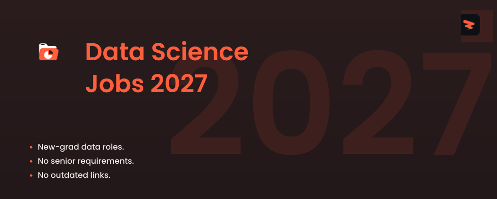

<!-- Cover -->

# Data Science Jobs 2027

🚀 Data science, analytics, and ML jobs for new graduates, updated every 10 minutes.

  
  
  
  

---

## **Website & Autofill Extension**

Explore Zapply's website and check out:

- Our Chrome extension, which autofills job applications in seconds.
- A dedicated job board featuring the latest openings across various roles.
- User accounts with multiple profiles for different resume types and roles.
- Job application tracking with streaks and commitment awards.

Experience an advanced career journey with us! 🚀

  

## Explore Around

Connect and seek advice from a growing network of fellow students and new grads.

  
  &nbsp;&nbsp;
  

---

 

<h3>🔬 <strong>Data Scientist</strong></h3>

| Company | Role | Location | Posted | Visa | **Apply** |
|---------|------|----------|--------|------|----------|
| **Baxter International** | Research Scientist I - Biochemistry | Round Lake, Illinois | 35m |  |  |
| **Aerospace Corporation** | 2027 Machine Learning Engineer Undergrad Intern | El Segundo, CA | 44m |  |  |
| **Adobe** | 2027 Intern - Applied and Research Scientist/Engineer | San Jose | 53m | ✅ Sponsor |  |
| **Adobe** | 2027 University Graduate - Research Scientist | San Jose | 53m | ✅ Sponsor |  |
| **Amgen** | Grad Intern - siRNA Stability and Data Science (Summer 2027) | California - Thousand Oaks | 1h | ✅ Sponsor |  |
| **NREL** | Graduate Student Intern (Spring Semester) – Commercial Vehicle Logistics and Data Science | Golden, CO | 1h | ✅ Sponsor |  |
| **Red Bull** | 2027 Internship, Spring - Data Science | Morristown, NJ | 1d | ✅ Sponsor |  |
| **Stantec** | Data Scientist Intern - Water (Summer 2027) | San Diego, CA, United States | 1d |  |  |
| **MITRE** | Data Science Intern | McLean, Virginia | 1d |  |  |
| **Baxter International** | Research Scientist I | Round Lake, Illinois | 3d |  |  |
| **Cisco** | Data Science Analyst II (Intern) – Untied States | San Jose, California, US | 3d | ✅ Sponsor |  |
| **Baxter International** | Research Scientist I - Material Science | Round Lake, Illinois | 3d |  |  |
| **Bristol Myers Squibb** | Data Science Intern (Undergrad)-Summer 2027 | Remote - United States - US | 3d | ✅ Sponsor |  |
| **Hitachi** | Data Scientist I (MAD-BS-OR) | (HTA) NCP | 3d | ✅ Sponsor |  |
| **Chan Zuckerberg Biohub** | AI Research Scientist Intern | New York, NY (Hybrid) | 3d | ✅ Sponsor |  |
| **NVIDIA** | Research Scientist, Physical AI - Foundation Models - PhD New College Grad 2026 | US, CA, Santa Clara | 4d | ✅ Sponsor |  |
| **NVIDIA** | Research Scientist, Electronic Design Automation - New College Grad 2026 | US, CA, Santa Clara | 4d | ✅ Sponsor |  |
| **NVIDIA** | Research Scientist, Fundamental Generative AI - New College Grad 2026 | US, CA, Santa Clara | 4d | ✅ Sponsor |  |
| **TransUnion** | Data Science & Analytics Internship - Summer 2027 | Chicago, Illinois | 4d | ✅ Sponsor |  |
| **Micron Technology** | New College Grad - Data Scientist, AI for Business Functions | Boise, ID - Main Site | 4d | ✅ Sponsor |  |
| **Apple** | Data Science, Conversion Optimization, Apple Retail Online | Cupertino | 4d | ✅ Sponsor |  |
| **Berkshire Hathaway Energy** | Mgr, Data Science | Des Moines, IA, United States | 4d |  |  |
| **Cisco** | Data Science Analyst II (Intern) – Untied States | San Jose, California | 4d | ✅ Sponsor |  |
| **Microsoft** | Data Science - Forward Deployed Engineer: PhD Internship Opportunities | Redmond, Washington, United States | 4d | ✅ Sponsor |  |
| **LabCorp** | Intern - Bioinformatics Scientist | Westborough, MA | 5d | ✅ Sponsor |  |
| **Zillow** | Applied Scientist (Economics) Intern | Seattle-WA | 5d | ✅ Sponsor |  |
| **Zillow** | Data Science Intern | Seattle-WA | 5d | ✅ Sponsor |  |
| **Bristol Myers Squibb** | Data Science Intern (MS/PhD)-Summer 2027 | Remote - United States - US | 5d | ✅ Sponsor |  |
| **Micron** | New College Grad - Data Scientist, AI for Business Functions | Boise, Idaho, United States of... | 5d |  |  |
| **Applied Materials** | 2027 Spring System Data Scientist /Analyst Co-op, MS or Phd - Gloucester, MA | Gloucester,MA | 5d | ✅ Sponsor |  |
| **Integra FEC** | Junior Data Scientist | Austin, Texas | 5d |  |  |
| **Booz Allen Hamilton** | University - 2027 Summer Games Data Scientist Intern - McLean, VA | McLean, VA | 5d | ✅ Sponsor |  |
| **Bose** | Data Science Co-Op (NLP & GenAI) | MA Framingham | 6d | ✅ Sponsor |  |
| **State Street** | State Street Investment Management - Data Scientist - Summer Internship 2027 | Boston, Massachusetts | 6d | ✅ Sponsor |  |
| **Aerospace Corporation** | 2027 Machine Learning Engineering Graduate Intern | El Segundo, CA | 6d |  |  |
| **Danaher** | Scientist I R&D | Fargo, North Dakota, United States | 6d |  |  |
| **MITRE** | Internships in Data Science, Math, Statistics or Operations Research | McLean, Virginia | 6d |  |  |
| **MITRE** | Data Science and Engineering Intern | McLean, Virginia | 6d |  |  |
| **Boston Scientific** | R&D Research Data Science Intern | United States   N/A | 6d |  |  |
| **Anduril** | 2027 Machine Learning Engineer Intern | Santa Ana, California, United... | 6d |  |  |
| **Booz Allen Hamilton** | University - 2027 Summer Games Data Scientist Intern - Ft. Walton Beach | Fort Walton Beach, FL | 6d | ✅ Sponsor |  |
| **Lumentum** | Internship - Data Science & Analytics | USA - CA - San Jose | 1w | ✅ Sponsor |  |
| **Entegris** | Research Scientist Intern - Summer 2027 | Aurora, IL | 1w | ✅ Sponsor |  |
| **NREL** | Graduate Internship (Year-Round) - Geospatial Data Science Modeling and Analysis | Golden, CO | 1w | ✅ Sponsor |  |
| **Micron Technology** | Intern - Data Science, SMAI | Boise, ID - Main Site | 1w | ✅ Sponsor |  |
| **Roblox** | \[2027\] Data Scientist - PhD Early Career - Safety | San Mateo, CA, United States | 1w | ✅ Sponsor |  |
| **Micron** | Intern - Data Science, SMAI | Boise, Idaho, United States of... | 1w |  |  |
| **ASML** | Internship - EUV Data Science and Analytics | Austin, TX, USA | 1w | ✅ Sponsor |  |
| **Symbotic** | Intern- PhD Applied Scientist, Robotics Planning | USA Wilmington,  MA - | 1w | ✅ Sponsor |  |
| **Adobe** | 2027 University Graduate - Data Scientist | San Jose | 1w | ✅ Sponsor |  |
| **Leidos** | Junior Software Engineer / Data Scientist Intern | Tucson, AZ | 1w | ✅ Sponsor |  |
| **ASML** | Internship - Data Scientist | Wilton, CT, USA | 1w | ✅ Sponsor |  |
| **Baker Hughes** | Productivity Data Science, Analytics & AI Specialist | NY-SKANEATELES | 1w | ✅ Sponsor |  |
| **Zoox** | Data Scientist Intern \[Summer 2027\] | Foster City, CA | 1w | ✅ Sponsor |  |
| **SharkNinja** | Summer 2027: Data Science Intern (May to August) | Needham, MA, United States | 1w | ✅ Sponsor |  |
| **AstraZeneca** | MS&T Process Associate Scientist | Frederick - MD | 1w | ✅ Sponsor |  |
| **Bloom Energy** | RMCC Data Science Intern | San Jose, California | 1w | ✅ Sponsor |  |
| **Bloom Energy** | Data Science Intern | San Jose, California | 1w | ✅ Sponsor |  |
| **Samsung Semiconductor** | Intern, AI System Architecture Research Scientist | San Jose, California, United States | 1w | ✅ Sponsor |  |
| **Riot Games** | Machine Learning Engineering Intern (Masters/PhD) - Summer 2027 | Los Angeles, USA | 1w | ✅ Sponsor |  |
| **The Hartford** | Data Science Intern - Summer 2027 | Hartford, CT | 1w | ✅ Sponsor |  |
| **General Motors** | 2027 Summer Intern – Machine Learning Engineer, AV/AI Platform | Sunnyvale, California, United... | 1w | ✅ Sponsor |  |
| **FIS** | Artificial Intelligence/Machine Learning Engineers | FL JAX 347 | 1w | ✅ Sponsor |  |
| **General Motors** | 2027 Summer Intern - Machine Learning Engineer, Embodied AI | Sunnyvale, California, United... | 1w | ✅ Sponsor |  |
| **Wellmark, Inc.** | Data Science Associate - FEP | Des Moines, IA | 1w | ✅ Sponsor |  |
| **Federal Reserve System** | Summer 2027 Graduate Internship – Data Science | Minneapolis, MN | 2w |  |  |
| **BAE Systems** | Data Scientist_ SPLUNK | Sterling, Virginia | 2w |  |  |
| **EliseAI** | Junior Research Scientist | San Francisco | 2w |  |  |
| **NBCUniversal** | Advertising & Partnerships: Data Science Internship – Summer 2027 | New York, NY | 2w | ✅ Sponsor |  |
| **Invesco** | Early Career Intern - Real Estate (Data Science) | Dallas, Texas | 2w |  |  |
| **Zoox** | Data Science Intern \[Summer 2027\] | Foster City, CA | 2w | ✅ Sponsor |  |
| **PayPal** | Data Scientist Intern - Summer 2027 | San Jose, California, United... | 2w | ✅ Sponsor |  |
| **PayPal** | Machine Learning Engineer Intern - Summer 2027 | San Jose, California, United... | 2w | ✅ Sponsor |  |
| **PayPal** | Machine Learning Engineer PhD Intern - Summer 2027 | San Jose, California, United... | 2w | ✅ Sponsor |  |
| **Match Group** | Data Scientist Intern | San Francisco, California | 2w |  |  |
| **Match Group** | Machine Learning Engineer Intern | Palo Alto, California | 2w |  |  |
| **Amgen** | Grad Intern – R&D TSRS Data Sciences Operations & Analytic (Summer 2027) | United States - Remote | 2w | ✅ Sponsor |  |
| **TEL** | Research Scientist - ATG Optical Sensor Development Intern (Summer 2027) | Austin RiverSouth | 2w |  |  |
| **Thomson Reuters** | Research Scientist Intern | MN | 2w | ✅ Sponsor |  |
| **Microsoft** | Data Science: PhD Internship Opportunities - Redmond | Redmond, Washington, United States | 2w | ✅ Sponsor |  |
| **KLA** | Machine Learning Engineer Intern | Milpitas, CA | 2w | ✅ Sponsor |  |
| **ByteDance** | Research Scientist - Intern (Video and Edge, Multimedia Lab) - 2027 Start | San Diego, California | Date unknown | ✅ Sponsor |  |
| **Booz Allen Hamilton** | University - 2027 Summer Games Data Scientist Intern - Royal Oak, MI | Detroit, MI | 3w | ✅ Sponsor |  |
| **Leidos** | Data Science Intern | Arlington, VA | 3w | ✅ Sponsor |  |
| **Northrop Grumman** | 2027 Intern Product Support – Data Scientist | United States-California-San Diego | 3w |  |  |
| **University of Miami** | Data Science & AI Intern | Miami, Florida | 3w |  |  |
| **Waymo** | 2027 Summer Intern, PhD, Research Scientist Intern | Mountain View, CA, USA | 3w | ✅ Sponsor |  |
| **ByteDance** | Research Scientist - Intern (Video and Edge, Multimedia Lab) - 2027 Start (PhD) | San Jose, California | Date unknown | ✅ Sponsor |  |
| **Stripe** | PhD Machine Learning Engineer, Intern | San Francisco, New York City,... | 3w | ✅ Sponsor |  |
| **Stripe** | Master's Machine Learning Engineer, Intern | San Francisco, New York City,... | 3w | ✅ Sponsor |  |
| **Microsoft** | Applied Scientist: Internship Opportunities, Turing | Redmond, Washington, United States | 3w | ✅ Sponsor |  |
| **Q2** | 2027 Summer Internship - Data Science | Cary, North Carolina | 3w |  |  |
| **Q2** | 2027 Summer Internship - Machine Learning Engineer | Cary, North Carolina | 3w |  |  |
| **Q2** | 2027 Summer Internship - Data Science | Austin, Texas | 3w |  |  |
| **Applied Materials** | Summer 2027 Data Scientist Intern -Bachelor's (Austin, TX) | Austin,TX | 3w | ✅ Sponsor |  |
| **Applied Materials** | Summer 2027 Data Scientist Intern - Master's (Santa Clara, CA) | Santa Clara,CA | 3w | ✅ Sponsor |  |
| **Micron Technology** | Intern - Data Science | San Jose, CA | 3w | ✅ Sponsor |  |
| **Visa** | Data Science Intern, Data and AI Team – Summer 2027 | Foster City, CA | 3w | ✅ Sponsor |  |
| **NXP** | Data Science / Structured Problem Solving Intern - Summer 2027 | Austin | 3w | ✅ Sponsor |  |
| **Saviynt** | Research Scientist Intern - PhD | Milpitas, California | 4w | ✅ Sponsor |  |

Apply for more jobs at

<h3>📊 <strong>Data Analyst</strong></h3>

| Company | Role | Location | Posted | Visa | **Apply** |
|---------|------|----------|--------|------|----------|
| **LabCorp** | Intern - Bioinformatics | Baltimore MD | 1h | ✅ Sponsor |  |
| **Becton Dickinson** | Local Master Data Specialist | USA CT - Canaan | 1h | ✅ Sponsor |  |
| **NREL** | Postdoctoral Researcher – Operations Research and Transportation Systems Optimization | Golden, CO | 1h | ✅ Sponsor |  |
| **National Interstate Insurance** | Predictive Analytics Intern - Summer 2027 | Cincinnati, OH | 2h |  |  |
| **CACI** | Data Engineering/Analytics Support | Norco, CA, US | 5h | ✅ Sponsor |  |
| **Vertex Pharmaceuticals** | Vertex Fellow Boston | Boston, MA | Date unknown |  |  |
| **Vertex Pharmaceuticals** | Vertex Fellow San Diego | San Diego, CA | Date unknown |  |  |
| **Vertex Pharmaceuticals** | Vertex Fellow Seattle, WA | Seattle, WA | Date unknown |  |  |
| **Microsoft** | Applied Sciences INTERN | United States | 23h | ✅ Sponsor |  |
| **AeroVironment** | Intelligence Analyst I | Albuquerque, NM | 2d |  |  |
| **Moderna** | 2027 Intern, TMF Systems & Operations | Cambridge, Massachusetts,... | 3d |  |  |
| **National Interstate Insurance** | Third-Party Risk & Analytics Intern (Year-Round) | Cincinnati, OH | 3d |  |  |
| **T-Mobile** | Summer 2027 Data Analyst Internship | Bellevue, Washington | 3d | ✅ Sponsor |  |
| **T-Mobile** | Summer 2027 Data Analyst Internship | Bellevue, Washington | 3d | ✅ Sponsor |  |
| **OpenAI** | Researcher, Cyber Safety Training | San Francisco | 3d | ✅ Sponsor |  |
| **Capital One** | Business Manager, Marketing, Analytics & Product Strategy | McLean, VA | 3d |  |  |
| **Impulse Space** | Supply Chain Data Analytics Intern (Summer 2027) | Redondo Beach, California | Date unknown |  |  |
| **John Deere** | Part-Time Student - Data Analytics - Moline, IL or Waterloo, IA or Des Moines, IA | Moline,Illinois,United States | 3d |  |  |
| **Microsoft** | Applied Sciences | United States | 3d | ✅ Sponsor |  |
| **GDIT** | Junior Intelligence Analyst - Onsite - Active Top Secret required | USA VA Vienna | 4d | ✅ Sponsor |  |
| **ICF** | GIS Analyst (Entry Level, Hybrid - Austin) | Austin, TX | 4d |  |  |
| **Moderna** | 2027 Co-Op, Biometrics | Cambridge, Massachusetts,... | 4d |  |  |
| **LLNL** | Operations Research Postdoctoral Researcher | Livermore, CA | 4d | ✅ Sponsor |  |
| **onsemi** | Spring 2027 - AI & Data Analytics Intern | Scottsdale, AZ, United States | 4d |  |  |
| **LLNL** | Protein Bioinformatics - Postdoctoral Researcher | Livermore, CA | 4d | ✅ Sponsor |  |
| **QuEra Computing** | Intern, Quantum Calibrations, Quantum Computing Services | Boston, MA, USA | 4d | ✅ Sponsor |  |
| **Applied Materials** | Summer 2027 Data Analyst Intern- Bachelor's (Santa Clara, CA) | Santa Clara,CA | 4d |  |  |
| **Per Scholas** | Instructional Assistant (Data Analytics) | United States | 4d |  |  |
| **USAA** | Decision Science Analyst I - Member Value | San Antonio | 5d | ✅ Sponsor |  |
| **Caterpillar** | Marketing Technology & Data Consultant | Irving Texas | 5d | ✅ Sponsor |  |
| **LabCorp** | RCM Data Analyst I - Hybrid | Burlington NC | 5d | ✅ Sponsor |  |
| **LabCorp** | RCM Data Analyst I - Hybrid | Burlington NC | 5d | ✅ Sponsor |  |
| **Crowe** | Data Analytics Manager with Crowe Advisory LLC (Indianapolis, IN) | Indianapolis IN USA | 5d |  |  |
| **National Interstate Insurance** | Risk Solutions Claims Intern - Summer 2027 | Cincinnati, OH | 5d |  |  |
| **Atlantic Health System** | Pharmacy (Data Analytics) Intern | Morristown, NJ, United States | 5d |  |  |
| **JND** | \[Entry Level\] Talent & Culture Analyst - HR Strategy, People Analytics & Employee Experience... | Plano, Texas | 5d | ✅ Sponsor |  |
| **Genentech** | 2027 Summer Intern – Translational Safety (Bioinformatics) | South San Francisco | 6d | ✅ Sponsor |  |
| **Amgen** | Grad Intern - Product Quality / Global Chemistry Manufacturing & Controls Statistician (Summer 2027) | United States - Remote | 6d | ✅ Sponsor |  |
| **Nelnet** | Intern - Data Analytics | Lincoln, NE | 6d | ✅ Sponsor |  |
| **T-Mobile** | Summer 2027 Business Intelligence Analyst Internship | New York, New York | 6d | ✅ Sponsor |  |
| **Capital One** | Manager Data Analysis - Global Payment Network | Chicago, IL | 6d | ✅ Sponsor |  |
| **Capital One** | Manager, Data Analysis - Credit Operations | McLean, VA | 6d |  |  |
| **ColdQuanta** | Quantum Physicist (Quantum Computing) | Louisville, Colorado | 6d |  |  |
| **ColdQuanta** | Quantum Physicist (Quantum Computing) | Chicago, Illinois | 6d |  |  |
| **ColdQuanta** | Quantum Physicist (Quantum Computing) | Madison, Wisconsin | 6d |  |  |
| **MITRE** | Applied Operations Research | Colorado Springs, Colorado | 6d |  |  |
| **Anduril** | 2027 Product Data Quality Co-op | Santa Ana, California, United... | 6d |  |  |
| **PNC Financial Services** | Business Analytics Specialist - Enterprise Risk Management | PA Pittsburgh 15222 | 6d | ✅ Sponsor |  |
| **Federal Reserve System** | Quantitative Fellowship Program - Federal Reserve System | Minneapolis, MN | 1w |  |  |
| **TransUnion** | Data Analysis Internship - Summer 2027 | Chicago, Illinois | 1w | ✅ Sponsor |  |
| **AstraZeneca** | Finance AI & Data Analytics Intern, Undergraduate - LIFT Program | Wilmington - DE | 1w | ✅ Sponsor |  |
| **Micron Technology** | Intern - Segment Marketing Data Analyst | San Jose, CA | 1w | ✅ Sponsor |  |
| **CACI** | Data Engineering/Analytics Support | Norco, CA, US | 1w | ✅ Sponsor |  |
| **General Atomics** | Deployable Intelligence Systems Operator (ASW/ELINT) | Jacksonville, Florida | 1w |  |  |
| **ABB** | Sales Excellence Data Analytics Intern - Summer 2027 | USA, NC, Cary | 1w | ✅ Sponsor |  |
| **Boston Scientific** | Product Data Analyst Intern | Marlborough US-MA, United... | 1w |  |  |
| **Micron** | Intern - Segment Marketing Data Analyst | San Jose, California, United... | 1w |  |  |
| **EXP** | Data Quality Specialist | New York, NY, United States | 1w |  |  |
| **Carrier Global** | Data Analytics Intern - Summer | CAI23: Carrier-Indianapolis,... | 1w |  |  |
| **Moderna** | 2027 Co-Op, Strategic Partnerships | Cambridge, Massachusetts,... | 1w |  |  |
| **Caterpillar** | Digital Product Owner - Data Analytics | Chicago Illinois | 1w | ✅ Sponsor |  |
| **Booz Allen Hamilton** | Marketing Analytics and Insights Data Visualization Specialist | McLean, VA | 1w | ✅ Sponsor |  |
| **Guidehouse** | Financial Management Functional Data Consultant | VA McLean | 1w | ✅ Sponsor |  |
| **Stanley Black & Decker** | Intern, Data Analyst & BI, Summer 2027 | Towson, MD, United States | 1w | ✅ Sponsor |  |
| **Amazon.com Services LLC** | 2027 Applied Science Internship - Robotics - United States | North Reading, MA | 1w | ✅ Sponsor |  |
| **University of Miami** | Assistant Professor in Computer Science - Quantum Computing | Coral Gables, Florida | 1w |  |  |
| **Microsoft** | Applied Science: Internship Opportunities - Redmond | Redmond, Washington, United States | 1w | ✅ Sponsor |  |
| **CVS Health** | Coordinator, Industry Analysis | IL Work from home | 1w | ✅ Sponsor |  |
| **onsemi** | Reporting and Data Analytics | Hopewell Junction, NY, United... | 1w |  |  |
| **Toyota Research Institute** | Future Product Innovation Research Intern, Human-AI Computational Design | Los Altos, CA | 1w | ✅ Sponsor |  |
| **Booz Allen Hamilton** | University - Summer 2027 Quantum Computing Research Intern | Washington, DC | 1w | ✅ Sponsor |  |
| **Amentum** | Biometrics Technician - Full Time | CA-Tustin | 1w |  |  |
| **Highmark Health** | Summer 2027 Data Analyst enGen Undergraduate Intern | Pittsburgh PA, 15222, PAP, Penn... | 1w | ✅ Sponsor |  |
| **Itron** | Intern - Data Analytics and Automation, Finance | WA | 2w | ✅ Sponsor |  |
| **AstraZeneca** | Network Planning & Data Analytics Intern | – Tarzana – CA | 2w | ✅ Sponsor |  |
| **NBCUniversal** | Studio Operations, Data Analytics Internships – Summer 2027 | Universal City, CA | 2w | ✅ Sponsor |  |
| **KLA** | Algorithm Engineering Intern | Ann Arbor, MI | 2w | ✅ Sponsor |  |
| **Lila Sciences** | Co-op, AI for Protein Design | San Francisco, CA USA | 2w | ✅ Sponsor |  |
| **Bosch Group** | Motorsport Software and Data Analytics Graduate Intern | Farmington Hills, MI | 2w | ✅ Sponsor |  |
| **CrowdStrike** | Sales Data Analytics Intern | Sunnyvale, CA | 2w | ✅ Sponsor |  |
| **onsemi** | Summer 2027 - IE / Data Analytics Intern | Hopewell Junction, NY, United... | 2w |  |  |
| **IMC Trading** | Research Analyst Intern - Summer 2027 | Chicago, United States | 2w | ✅ Sponsor |  |
| **Dell Technologies** | Global Marketing Graduate AI & Data Intern | Round Rock, TX, United States | 3w |  |  |
| **WSP** | Transportation Data Analyst Intern - Summer 2027 | Seattle, WA, United States | 3w | ✅ Sponsor |  |
| **University of Miami** | Postdoctoral Associate - Cancer, Lifestyle Medicine & Data Analytics | Miami, Florida | 3w |  |  |
| **Cisco** | Data Analyst I (Intern) - United States | San Jose California US | 3w | ✅ Sponsor |  |
| **UPS** | MHR Summer 2027 Intern - Data Analytics (HR Systems) | ATLANTA, Georgia | 3w |  |  |
| **Illinois Tool Works** | Marketing Research Analyst Intern (Summer 2027) | Glenview, Illinois | 3w | ✅ Sponsor |  |
| **Cisco** | Data Analyst I (Intern) - United States | San Jose, California | 3w | ✅ Sponsor |  |
| **Toyota Research Institute** | Human Interactive Driving Research Intern, Decision-Making for Driving at the Limits | Los Altos, CA | 3w | ✅ Sponsor |  |
| **Applied Materials** | Summer 2027 Business Intelligence Analyst Intern- Master's (Santa Clara, CA) | Santa Clara,CA | 3w | ✅ Sponsor |  |
| **Micron Technology** | Intern - Memory Performance and Power Modeling | San Jose, CA | 3w | ✅ Sponsor |  |
| **Arrowstreet Capital** | Investment Processes Intern, Summer 2027 | Boston | 3w |  |  |
| **The Travelers Companies** | Decision Science - Marketing & Communications Intern | CT - Hartford | 4w |  |  |
| **Thermo Fisher Scientific** | Sr. Operations Data Analytics Intern | Logan, Utah, USA | 4w | ✅ Sponsor |  |
| **Lila Sciences** | Co-Op, Reaction Prediction & Benchmarking | Cambridge, MA USA | 4w | ✅ Sponsor |  |
| **Lila Sciences** | Co-Op, Agentic Simulations for Materials Science | Cambridge, MA USA | 4w | ✅ Sponsor |  |
| **Stevens Capital Management** | Quantitative Research Analyst Internship | Radnor, PA | Date unknown |  |  |
| **D. E. Shaw** | Quantitative Researcher Intern (New York) – Summer 2027 | New York | Date unknown |  |  |
| **D. E. Shaw** | Quantitative Researcher, Ph.D. Intern (New York) – Summer 2027 | New York | Date unknown |  |  |

Apply for more jobs at

<h3>🔧 <strong>Data Engineer</strong></h3>

| Company | Role | Location | Posted | Visa | **Apply** |
|---------|------|----------|--------|------|----------|
| **Amazon.com Services LLC** | Data Engineer I, Intelligent Talent Acquisition (ITA) - Data | Seattle, WA | 1d | ✅ Sponsor |  |
| **Leidos** | Data Engineer Intern | Fort Belvoir, VA | 3d | ✅ Sponsor |  |
| **Intuitive** | Data Engineering Intern | Sunnyvale, CA | 3d | ✅ Sponsor |  |
| **Starbucks** | engineer I, Operations Data Engineering (Seattle, WA) | 1101 Church ST, Nashville,... | 3d | ✅ Sponsor |  |
| **The Travelers Companies** | Data Engineer I (AWS, Python, GenAI) | CT Hartford | 4d |  |  |
| **Highmark Health** | Summer 2027 Data Engineer & Analyst enGen Undergraduate Intern | Pittsburgh PA, 15222, PAP, Penn... | 4d | ✅ Sponsor |  |
| **Amazon.com Services LLC** | Data Engineer I | Bellevue, WA | 4d | ✅ Sponsor |  |
| **State Street** | Data Engineering & Product, Technology Intern - Full-time Internship (Jan - June 2027) | Quincy, Massachusetts | 5d | ✅ Sponsor |  |
| **State Street** | Data Engineering & Product, Technology Intern - Full-time Internship (Jan - June 2027) | Boston, Massachusetts | 5d | ✅ Sponsor |  |
| **National Interstate Insurance** | Data Engineer Developer Intern – Summer 2027 | Cincinnati, OH | 5d |  |  |
| **Dell Technologies** | Consultant, Data Engineering | TX, United States | 5d |  |  |
| **Dell Technologies** | Consultant, Data Engineering | TX, United States | 5d |  |  |
| **Crest Industries** | Data Engineer I | Ruston, Louisiana | 5d |  |  |
| **Booz Allen Hamilton** | Scientific Data Engineering Specialist | McLean, VA | 1w | ✅ Sponsor |  |
| **ASML** | Internship/Co-Op: Data Engineer | San Diego, CA, USA | 1w | ✅ Sponsor |  |
| **BAE Systems** | Data Engineer_ SPLUNK | Sterling, Virginia | 1w |  |  |
| **Entegris** | Data Engineering Intern - Summer 2027 | Aurora, IL | 1w | ✅ Sponsor |  |
| **Riot Games** | Data Engineering Intern - Summer 2027 | Los Angeles, USA | 1w | ✅ Sponsor |  |
| **T-Mobile** | Summer 2027 Data Engineering Internship | Frisco Texas | 2w | ✅ Sponsor |  |
| **T-Mobile** | Summer 2027 Data Engineering Internship | Frisco Texas | 2w | ✅ Sponsor |  |
| **Tenet Healthcare** | Data Engineer Intern  – Summer 2027 – Onsite in Dallas, TX | Dallas, TX, United States | 2w |  |  |
| **Firework** | Data Engineer Intern | San Mateo, California | 3w | ✅ Sponsor |  |
| **Philips** | Co-op – Data Engineer (Biocompatibility) – Murrysville, PA – January to June 2027 | Murrysville, Pennsylvania,... | 3w | ✅ Sponsor |  |
| **GM Financial** | Intern - Data Engineer | Arlington, TX, United States | 3w |  |  |
| **National Interstate Insurance** | Data Engineering Intern – Summer 2027 | Cincinnati, OH | 3w |  |  |
| **National Interstate Insurance** | Cloud Data Platform Intern - Summer 2027 | Cincinnati, OH | 3w |  |  |
| **Wells Fargo** | 2027 Technology Summer Internship – Early Careers (Data Engineering) | CHARLOTTE, NC | 4w | ✅ Sponsor |  |
| **CVS Health** | Innovation & Technology Internship – Data Engineering – Summer 2027 (Undergraduate) | TX - Irving | 4w | ✅ Sponsor |  |
| **Campbell Soup Company** | Data Engineer, DA&AI Co-Op | USA - NJ - Camden | 1mo |  |  |
| **Campbell Soup Company** | Data Engineer - Operational Support (Co-op) | USA - NJ - Camden | 1mo |  |  |
| **Campbell Soup Company** | Data Engineer – Agentic AI & ML Ops (Co-op) | USA - NJ - Camden | 1mo |  |  |
| **Symbotic** | Intern- Data Engineer | USA Wilmington,  MA - | 1mo | ✅ Sponsor |  |
| **Philips** | Co-op-Data Engineering-Reedsville, PA-July-December 2027 | Reedsville, Pennsylvania,... | 1mo | ✅ Sponsor |  |
| **LPL Financial** | Intern 2027 - Data Engineer | Fort MillCharlotte | 1mo | ✅ Sponsor |  |
| **CVS Health** | Innovation & Technology Internship – Data Engineering – Summer 2027 (Undergraduate) | NY - New York | 1mo | ✅ Sponsor |  |
| **CVS Health** | Innovation & Technology Internship – Data Engineering – Summer 2027 (Graduate) | NY - New York | 1mo | ✅ Sponsor |  |
| **Stryker** | Summer 2027 Internship - Data Engineering - Indiana | Fort Wayne, Indiana | 1mo | ✅ Sponsor |  |
| **Marmon Holdings** | Data Engineering Intern OR Student Co-Op | Milwaukee, WI | 1mo |  |  |
| **Oshkosh Corporation** | Data Engineer Intern | Oshkosh, Wisconsin, United States | 1mo | ✅ Sponsor |  |
| **First Solar** | Data Engineering Intern (Spring 2027) | Perrysburg, OH, United States | 1mo | ✅ Sponsor |  |
| **Figma** | Data Engineer Intern (2027) | San Francisco, CA • New York, NY | 2026-09-23 | ✅ Sponsor |  |
| **Amazon.com Services LLC** | Data Engineer Internship - 2027 (US) | Seattle, WA | 2026-09-18 | ✅ Sponsor |  |
| **Texas Instruments** | Information Technology Intern – Data Engineering | Dallas, TX, United States | 2026-09-15 | ✅ Sponsor |  |
| **Databricks** | Specialist Solutions Architect - Data Engineering & Warehousing (Financial Services) | United States | 2026-08-10 | ✅ Sponsor |  |
| **Jump Trading** | Campus Data Engineer (Intern) | Chicago | 2026-07-08 | ✅ Sponsor |  |
| **Octaura** | Intern, Data Engineering | New York | 2025-03-04 |  |  |

Apply for more jobs at

<h3>📈 <strong>Business Intelligence</strong></h3>

| Company | Role | Location | Posted | Visa | **Apply** |
|---------|------|----------|--------|------|----------|
| **Apple** | Business Intelligence and Reporting Program Manager, Places | San Jose | 9h | ✅ Sponsor |  |
| **Bloom Energy** | Commercial Business Intelligence Intern | San Jose, California | 5d | ✅ Sponsor |  |
| **Emerson Electric** | Business Intelligence Manager | Austin, TX, United States | 5d | ✅ Sponsor |  |
| **Moog** | Werkstudent (m/w/d) – Business Intelligence & Automation | Böblingen, DE | 6d |  |  |
| **Wolters Kluwer** | Business Intelligence Manager | USA - Houston, TX, Allen Pkwy | 1w | ✅ Sponsor |  |
| **National Interstate Insurance** | Business Intelligence (Power BI) Intern - Summer 2027 | Cincinnati, OH | 2w |  |  |
| **Sherwin-Williams** | 2027 R&D Data Visualization Intern- Cleveland | Brecksville, OH, United States | 3w | ✅ Sponsor |  |
| **Divergent Technologies** | Summer 2027 Business Intelligence Intern | Torrance, California, United States | 3w |  |  |
| **HP Inc** | Business Intelligence and Infrastructure Analysts  Intern | Vancouver, Washington, United... | 1mo | ✅ Sponsor |  |
| **Bracebridge Capital** | Northeastern University Software Engineer - Business Intelligence Co-op | Boston | 1mo | ✅ Sponsor |  |
| **Amazon.com Services LLC** | Business Intelligence Engineer Internship - 2027 (US) | Seattle, WA | 2026-09-18 | ✅ Sponsor |  |
| **Accenture Federal Services** | Data Visualization Specialist | Suitland, MD | 2026-05-22 |  |  |

Apply for more jobs at

<h3>🤖 <strong>Machine Learning</strong></h3>

| Company | Role | Location | Posted | Visa | **Apply** |
|---------|------|----------|--------|------|----------|
| **Genentech** | Postdoctoral Fellow Computational Biology and Machine Learning, Jhunjhunwala Lab | South San Francisco | 35m | ✅ Sponsor |  |
| **ASML** | Internship/Co-Op: AI Engineer | San Jose, CA, USA | 44m | ✅ Sponsor |  |
| **ASML** | Internship/Co-Op: AI Engineer | San Diego, CA, USA | 44m | ✅ Sponsor |  |
| **MITRE** | AI Engineering Intern | Bedford, Massachusetts | 1d |  |  |
| **Microsoft** | Research Intern - AI /Machine Learning Numerics & Efficiency | Mountain View, California,... | 3d | ✅ Sponsor |  |
| **NVIDIA** | Finance AI Engineering Intern - Summer 2027 | US, CA, Santa Clara | 4d | ✅ Sponsor |  |
| **HPE (University)** | AI Engineering Technical Intern | Sunnyvale, California | 4d | ✅ Sponsor |  |
| **LinkedIn** | AI/ML Engineer Intern, Master's - Summer 2027 (Mountain View, CA) | Mountain View, CA | 4d | ✅ Sponsor |  |
| **T-Mobile** | Summer 2027 AI Engineering Internship - Site Reliability & Automation | Atlanta, Georgia | 4d | ✅ Sponsor |  |
| **LinkedIn** | AI/ML Engineer Intern – Generative AI, PhD – Summer 2027 (Mountain View, CA) | Mountain View, CA | 4d | ✅ Sponsor |  |
| **LinkedIn** | AI/ML Engineer Intern – Search and Recommender Systems, PhD – Summer 2027 (Mountain View, CA) | Mountain View, CA | 4d | ✅ Sponsor |  |
| **LLNL** | Machine Learning (ML) Bioengineer | Livermore, CA | 4d | ✅ Sponsor |  |
| **Lucid Motors** | Intern, AI & Data (Applied AI/Machine Learning), Summer 2027 | Newark, CA | 4d | ✅ Sponsor |  |
| **Northrop Grumman** | 2027 AI/ML Engineering Intern - Morrisville NC | United States-North... | 4d |  |  |
| **Microsoft** | Research Intern - AI /Machine Learning Numerics & Efficiency | Redmond, Washington, United States | 4d | ✅ Sponsor |  |
| **Fiserv** | AI Engineering Specialist | Coral Springs, Florida | 5d | ✅ Sponsor |  |
| **State Street** | Agentic AI Engineering, Technology Intern - Full-time Internship (Jan - June 2027) | Burlington Massachusetts | 5d | ✅ Sponsor |  |
| **State Street** | Agentic AI Engineering, Technology Intern - Full-time Internship (Jan - June 2027) | Burlington Massachusetts | 5d | ✅ Sponsor |  |
| **State Street** | AI Engineering Intern - Full-time Internship (Jan - June 2027) | Cambridge, Massachusetts | 5d | ✅ Sponsor |  |
| **ICF** | 2027 Summer Intern, AI Engineer (Master's Degree, Reston, VA) | Reston, VA | 5d |  |  |
| **D. E. Shaw** | Quantitative Researcher: Machine Learning | New York | Date unknown | ✅ Sponsor |  |
| **KLA** | Computer Vision/Machine Learning Intern | Milpitas, CA | 6d | ✅ Sponsor |  |
| **Carnegie Mellon SEI** | AI Engineer Intern - Mission Innovation Lab (Summer 2027) | Pittsburgh, PA | 1w |  |  |
| **Carnegie Mellon University** | AI Engineer Intern - Mission Innovation Lab (Summer 2027) | Pittsburgh, PA | 1w | ✅ Sponsor |  |
| **T-Mobile** | Summer 2027 AI Engineering Internship | Bellevue, Washington | 1w | ✅ Sponsor |  |
| **Toyota Research Institute** | Automated Driving Advanced Development Intern, Machine Learning Research (Cambridge) | Cambridge, MA | 1w | ✅ Sponsor |  |
| **Carnegie Mellon SEI** | Cyber AI Engineering Intern (Spring 2027) | Pittsburgh, PA | 1w |  |  |
| **Postman** | AI Engineer, Intern | San Francisco, CA, US | 1w | ✅ Sponsor |  |
| **Carnegie Mellon University** | Cyber AI Engineering Intern (Spring 2027) | Pittsburgh, PA | 1w | ✅ Sponsor |  |
| **Micron Technology** | Intern -  AI Engineer Platform | Boise, ID - Main Site | 1w | ✅ Sponsor |  |
| **Micron** | Intern -  AI Engineer Platform | Boise, Idaho, United States of... | 1w |  |  |
| **BAE Systems** | AI/ML Engineer Intern, Summer 2027 | Rockville, Maryland | 1w |  |  |
| **Bose** | Agentic AI Engineering Co-op – Active Noise Cancellation   Fall 2027 | US, MA - Framingham | 1w | ✅ Sponsor |  |
| **ServiceNow** | Assoc AI Engineering (Cloud Security Automation) Intern | Santa Clara, CALIFORNIA | 1w | ✅ Sponsor |  |
| **Apple** | Machine Learning Researcher: Agentic Post-Training for On-Device Models | Sunnyvale | 1w | ✅ Sponsor |  |
| **Toyota Research Institute** | Automated Driving Advanced Development Intern, Machine Learning Research | Los Altos, CA | 1w | ✅ Sponsor |  |
| **LLNL** | Physics-Informed Machine Learning - Postdoctoral Researcher | Livermore, CA | 1w | ✅ Sponsor |  |
| **ASML** | Internship- Co-Op: AI Engineer | San Diego, CA, USA | 1w | ✅ Sponsor |  |
| **Analog Devices** | Machine Learning for Computational Sensing Research Intern | US, MA, Boston | 2w | ✅ Sponsor |  |
| **Toyota Research Institute** | Automated Driving Advanced Development Intern, Machine Learning Research | Los Altos, CA | 2w | ✅ Sponsor |  |
| **NBCUniversal** | Media Tech: Data, AI & Machine Learning Internships – Summer 2027 | Universal City, CA | 2w | ✅ Sponsor |  |
| **NBCUniversal** | Media Tech: Data, AI & Machine Learning Internships – Summer 2027 | New York, NY | 2w | ✅ Sponsor |  |
| **CACI** | AI/ML Engineering Co-op - Spring 2027 | King of Prussia, PA, US | 2w | ✅ Sponsor |  |
| **Parspec** | Applied AI Engineer Intern | Hybrid - San Mateo, California | 2w |  |  |
| **Waymo** | 2027 Summer Intern, PhD, Machine Learning - Generative World Models & Controllable Simulation | Mountain View, California,... | 2w | ✅ Sponsor |  |
| **Waymo** | 2027 Summer Intern, Machine Learning, MS/PhD, Simulation Realism (World Model) | Mountain View, California,... | 2w | ✅ Sponsor |  |
| **ICD** | Summer 2027 AI/ML Engineering Internship | Jersey City, NJ, United States | 2w |  |  |
| **Tradeweb** | Summer 2027 AI/ML Engineering Internship | Jersey City, NJ, United States | 2w |  |  |
| **ABB** | AI Engineering, ERP Intern- Summer 2027 | USA, NC, Cary | 2w | ✅ Sponsor |  |
| **ABB** | AI Engineering, Business Systems Intern- Summer 2027 | USA, NC, Cary | 2w | ✅ Sponsor |  |
| **Parsons** | AI/ML Engineering Intern Summer 2027 | VA, Centreville, R188194 | Date unknown |  |  |
| **Intuitive** | AI/ML Engineer Intern | Sunnyvale, CA | 3w | ✅ Sponsor |  |
| **Roku** | Software Engineer Intern, AI Engineering | San Jose, California | 3w | ✅ Sponsor |  |
| **General Motors** | 2027 Summer Intern – Research and Development – Vehicle Aerodynamics and Machine Learning | Warren, Michigan, United States... | 3w | ✅ Sponsor |  |
| **Applied Materials** | New College Grad - Computational Physics & Agentic AI Engineer, Doctorate Degree (Spring 2027) | Santa Clara,CA | 3w | ✅ Sponsor |  |
| **General Motors** | 2027 Summer Intern - AI/ML Engineer - Autonomous Vehicles | Sunnyvale, California, United... | 3w | ✅ Sponsor |  |
| **T-Mobile** | Summer 2027 Assoc AI Engineer Internship | Overland Park, Kansas | 3w | ✅ Sponsor |  |
| **Amazon.com Services LLC** | Software Development Engineer Intern, Machine Learning/Automated Reasoning- Summer 2027 | Seattle, WA | 3w | ✅ Sponsor |  |
| **Microsoft** | Research Intern - Machine Learning and Optimization - Redmond | Redmond, Washington, United States | 3w | ✅ Sponsor |  |
| **Entegris** | Lab Automation & AI Engineering Co-Op | Billerica, MA | 3w | ✅ Sponsor |  |
| **General Motors** | 2027 Summer Intern, AI/ML Engineer, Mapping (PhD) | Warren, Michigan, United States... | 4w | ✅ Sponsor |  |
| **Micron Technology** | Intern - SMAI Probe AI Engineer | Boise, ID - Main Site | 1mo | ✅ Sponsor |  |
| **Nissan** | Machine Learning Research Prediction and Planning Intern - Spring 2027 - Santa Clara, CA | Santa Clara, California -... | 1mo |  |  |
| **Nissan** | Machine Learning Research Intern - Spring 2027 - Santa Clara, CA | Santa Clara, California -... | 1mo |  |  |
| **Nissan** | Machine Learning Research Perception Intern - Spring 2027 - Santa Clara, CA | Santa Clara, California -... | 1mo |  |  |
| **Bose** | Audio Machine Learning Co-op | US, MA - Framingham | 1mo | ✅ Sponsor |  |
| **Campbell Soup Company** | Agentic AI Engineer Co-Op | USA - Remote | 1mo |  |  |
| **Campbell Soup Company** | Agentic AI Engineer Co-Op | USA - Remote | 1mo |  |  |
| **Symbotic** | Co-op- Machine Learning Ops | USA Wilmington,  MA - | 1mo | ✅ Sponsor |  |
| **Symbotic** | Intern- Machine Learning Ops | USA Wilmington,  MA - | 1mo | ✅ Sponsor |  |
| **AeroVironment** | Summer 2027 Machine Learning Intern | Minneapolis, MN | 1mo |  |  |
| **KLA** | Algorithm Engineering Intern (AI, Computer Vision & Software Engineering) | Milpitas, CA | 1mo | ✅ Sponsor |  |
| **Expedia Group** | Machine Learning Science Intern - PhD - 2026 - Austin, San Jose | Austin Domain 11 HomeAway | 1mo | ✅ Sponsor |  |
| **Expedia Group** | 2023 PhD Intern - Machine Learning Science | Austin Domain 11 HomeAway | 1mo | ✅ Sponsor |  |
| **Crowe** | Machine Learning Intern | Chicago, IL | 1mo |  |  |
| **Capital One** | Current PhD, AI Engineering Internship Program - Summer 2027 | New York, NY | 1mo | ✅ Sponsor |  |
| **Capital One** | Current Master's, AI Engineering Internship Program - Summer 2027 | New York, NY | 1mo | ✅ Sponsor |  |
| **Waymo** | 2027 Summer Intern, MS/PhD, Machine Learning, Driver Refinement Foundations | San Francisco, CA, USA | 1mo | ✅ Sponsor |  |
| **Amperesand** | AI/ML Engineering Intern | Sunnyvale, California, United... | 1mo | ✅ Sponsor |  |
| **Flagship Pioneering** | ProFound Therapeutics: AI/ML Engineering - SAGE Platform Co-Op | Cambridge, MA USA | 1mo |  |  |
| **Avalore** | Machine Learning and Python SME | Chantilly, Virginia | 1mo |  |  |
| **Micron** | Intern - SMAI Probe AI Engineer | Boise, Idaho, United States of... | 1mo |  |  |
| **Nike** | NIKE, Inc. AI & Machine Learning, Innovation Graduate Internship | Beaverton, Oregon | 1mo | ✅ Sponsor |  |
| **Scale AI** | Machine Learning Research Intern (Summer 2027) | New York, NY | 1mo | ✅ Sponsor |  |
| **Analog Devices** | AI/ML Engineer Intern | MA Wilmington | 1mo | ✅ Sponsor |  |
| **ServiceNow** | AI Engineering - Assoc Software Engineer Internships - Summer 2027 (Bachelors) | Santa Clara, CALIFORNIA | 1mo | ✅ Sponsor |  |
| **ServiceNow** | AI Engineering - Software Engineer Internships - Summer 2027 (Masters) | Santa Clara, CALIFORNIA | 1mo | ✅ Sponsor |  |
| **Micron Technology** | Intern - SMAI TD AI Engineering Team | Boise, ID - Main Site | 1mo | ✅ Sponsor |  |
| **Bosch Group** | Artificial Intelligence / Machine Learning: Foundation Models - Intern | Sunnyvale, CA | 1mo | ✅ Sponsor |  |
| **Lyft** | PhD Machine Learning Software Engineer Intern (Summer 2027) | San Francisco, CA | 1mo | ✅ Sponsor |  |
| **Nokia** | AI Engineering Co-op | United States | 1mo | ✅ Sponsor |  |
| **Pinterest** | Master's Machine Learning Internship 2027 (USA) | San Francisco, CA, US | 1mo | ✅ Sponsor |  |
| **Pinterest** | PhD Machine Learning Internship 2027 (USA) | San Francisco, CA, US | 1mo | ✅ Sponsor |  |
| **Amazon.com Services LLC** | 2027 Applied Science Internship - Reinforcement Learning & Optimization (Machine Learning) -... | Seattle, WA | 1mo | ✅ Sponsor |  |
| **Amazon.com Services LLC** | 2027 Applied Science Internship - Recommender Systems/ Information Retrieval (Machine Learning)... | Seattle, WA | 1mo | ✅ Sponsor |  |
| **Honeywell** | Spring 2027 Artificial Intelligence/Machine Learning Co-Op | United States | 1mo | ✅ Sponsor |  |
| **DoorDash** | Machine Learning Intern (PhD) - Summer 2027 | San Francisco, CA | 1mo | ✅ Sponsor |  |
| **DoorDash** | Machine Learning Intern (Masters) - Summer 2027 | San Francisco, CA | 2026-09-24 | ✅ Sponsor |  |
| **IMC Trading** | Hardware Machine Learning PhD Research Internship | Chicago, United States | 2026-09-23 | ✅ Sponsor |  |
| **Qualcomm** | Machine Learning & Artificial Intelligence Engineering Internship – Summer 2027 | San Diego, CA | 2026-09-18 | ✅ Sponsor |  |

Apply for more jobs at

---

### Live Job Boards

  
  &nbsp;&nbsp;
  
  &nbsp;&nbsp;
  

  
  &nbsp;&nbsp;
  
  &nbsp;&nbsp;
  

  
  &nbsp;&nbsp;
  
  &nbsp;&nbsp;
  

  

### Curated Internships

  
  &nbsp;&nbsp;
  
  &nbsp;&nbsp;
  

  
  &nbsp;&nbsp;
  

### Career Resources

  
  &nbsp;&nbsp;
  

---

Add new jobs to our listings keeping in mind the following:

- Located in the US.
- Create a new issue to submit different job positions.
- Update a job by submitting an issue with the job URL and required changes.

Our team reviews within 24-48 hours and approved jobs are added to the main list!

Questions? Create a miscellaneous issue, and we'll assist! 🙏

**🎯 728 current opportunities from 239 companies**

**Found this helpful? Give it a ⭐ to support Zapply!**

*Not affiliated with any companies listed. All applications redirect to official career pages.*

---

## Data & Reuse

Job listings are public information provided by employers, who remain responsible for their accuracy. The compilation and the added data fields (skills, degree and visa estimates, tags) are by Zapply.

You may use, share, and build on this data, including for commercial purposes, as long as you:

- Link back to this repository as the source (followed link, no nofollow).
- Credit Zapply as the data source.
- Do not resubmit the listings to third-party job aggregators or feeds.
- Do not present Zapply enrichment fields as official employer statements; they are automated estimates provided as-is, without warranty.

You may use the name Zapply to attribute the data. Please do not use the Zapply logo or imply endorsement without written permission.

Questions or a different use? Open an issue. We say yes more often than not.

---

**Last Updated**: November 24, 2026

