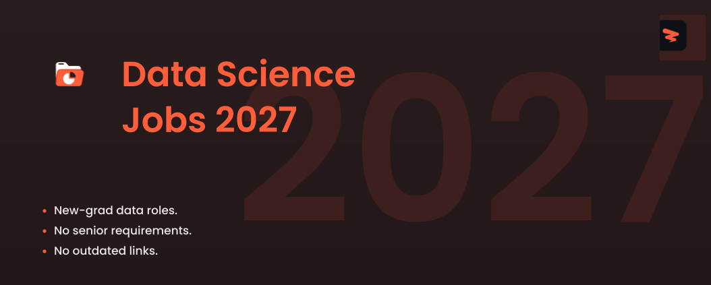

<!-- Cover -->

# Data Science Jobs 2027

🚀 Data science, analytics, and ML jobs for new graduates, updated every 10 minutes.

  
  
  
  

---

## **Website & Autofill Extension**

Explore Zapply's website and check out:

- Our Chrome extension, which autofills job applications in seconds.
- A dedicated job board featuring the latest openings across various roles.
- User accounts with multiple profiles for different resume types and roles.
- Job application tracking with streaks and commitment awards.

Experience an advanced career journey with us! 🚀

  

## Explore Around

Connect and seek advice from a growing network of fellow students and new grads.

  
  &nbsp;&nbsp;
  

---

 

<h3>🔬 <strong>Data Scientist</strong></h3>

| Company | Role | Location | Posted | Visa | **Apply** |
|---------|------|----------|--------|------|----------|
| **Samsung Semiconductor** | Intern, AI System Architecture Research Scientist | San Jose, California, United States | 15h | ✅ Sponsor |  |
| **Riot Games** | Machine Learning Engineering Intern (Masters/PhD) - Summer 2027 | Los Angeles, USA | 19h | ✅ Sponsor |  |
| **Adobe** | 2027 University Graduate - Data Scientist | San Jose | 1d | ✅ Sponsor |  |
| **Genentech** | 2027 Summer Intern - Product Development Data Sciences | Boston | 1d | ✅ Sponsor |  |
| **Genentech** | 2027 Summer Intern - Biostatistics and Analytical Data Sciences | South San Francisco | 1d | ✅ Sponsor |  |
| **Bloom Energy** | RMCC Data Science Intern | San Jose, California | 1d | ✅ Sponsor |  |
| **Bloom Energy** | Data Science Intern | San Jose, California | 1d | ✅ Sponsor |  |
| **AstraZeneca** | MS&T Process Associate Scientist | Frederick - MD | 1d | ✅ Sponsor |  |
| **Wellmark, Inc.** | Data Science Associate - FEP | Des Moines, IA | 1d | ✅ Sponsor |  |
| **General Motors** | 2027 Summer Intern – Machine Learning Engineer, AV/AI Platform | Sunnyvale, California, United... | 2d | ✅ Sponsor |  |
| **General Motors** | 2027 Summer Intern - Machine Learning Engineer, Embodied AI | Sunnyvale, California, United... | 2d | ✅ Sponsor |  |
| **The Hartford** | Data Science Intern - Summer 2027 | Hartford, CT | 2d | ✅ Sponsor |  |
| **FIS** | Artificial Intelligence/Machine Learning Engineers | FL JAX 347 | 2d | ✅ Sponsor |  |
| **Micron Technology** | New College Grad - Data Scientist, AI for Business Functions | Boise, ID - Main Site | 2d | ✅ Sponsor |  |
| **Baker Hughes** | Productivity Data Science, Analytics & AI Specialist | NY-SKANEATELES | 2d | ✅ Sponsor |  |
| **Amazon.com Services LLC** | Applied Scientist I, Tablet Product Software | Seattle, WA | 2d | ✅ Sponsor |  |
| **Micron** | New College Grad - Data Scientist, AI for Business Functions | Boise, Idaho, United States of... | 2d |  |  |
| **EliseAI** | Junior Research Scientist | San Francisco | 2d |  |  |
| **NBCUniversal** | Advertising & Partnerships: Data Science Internship – Summer 2027 | New York, NY | 2d | ✅ Sponsor |  |
| **Federal Reserve System** | Summer 2027 Graduate Internship – Data Science | Minneapolis, MN | 3d |  |  |
| **AstraZeneca** | Associate Scientist | Gaithersburg - MD | 3d |  |  |
| **Morgan Stanley** | Assistant Vice President, Data Science & Analysis | Jersey City, New Jersey, United... | 3d | ✅ Sponsor |  |
| **Amazon.com Services LLC** | Data Scientist I, NEST | Bellevue, WA | 3d | ✅ Sponsor |  |
| **MITRE** | Data Science Intern | McLean, Virginia | 4d |  |  |
| **Zoox** | Data Science Intern \[Summer 2027\] | Foster City, CA | 5d | ✅ Sponsor |  |
| **Invesco** | Early Career Intern - Real Estate (Data Science) | Dallas, Texas | 6d |  |  |
| **NVIDIA** | Research Scientist, AI and Systems Security - PhD New College Grad 2026 | MA Westford | 6d | ✅ Sponsor |  |
| **NVIDIA** | PhD Research Scientist, Fundamental Generative AI - New College Grad 2026 | US, CA, Santa Clara | 6d | ✅ Sponsor |  |
| **Zillow** | Applied Scientist (Economics) Intern | Seattle-WA | 6d | ✅ Sponsor |  |
| **Zillow** | Data Science Intern | Seattle-WA | 6d | ✅ Sponsor |  |
| **Capital One** | Manager, Data Science - Model Risk Office | McLean, VA | 6d | ✅ Sponsor |  |
| **Match Group** | Data Scientist Intern | San Francisco, California | 6d |  |  |
| **Match Group** | Machine Learning Engineer Intern | Palo Alto, California | 6d |  |  |
| **Eurofins** | ELISA Method Development and Validation Research Scientist I | Lenexa, KS | 6d |  |  |
| **PayPal** | Data Scientist Intern - Summer 2027 | San Jose, California, United... | 1w | ✅ Sponsor |  |
| **PayPal** | Machine Learning Engineer Intern - Summer 2027 | San Jose, California, United... | 1w | ✅ Sponsor |  |
| **PayPal** | Machine Learning Engineer PhD Intern - Summer 2027 | San Jose, California, United... | 1w | ✅ Sponsor |  |
| **Microsoft** | Data Science: PhD Internship Opportunities - Redmond | Redmond, Washington, United States | 1w | ✅ Sponsor |  |
| **Thomson Reuters** | Research Scientist Intern | MN | 1w | ✅ Sponsor |  |
| **Symbotic** | Intern- PhD Applied Scientist, Robotics Planning | USA Wilmington,  MA - | 1w | ✅ Sponsor |  |
| **Amgen** | Grad Intern – R&D TSRS Data Sciences Operations & Analytic (Summer 2027) | United States - Remote | 1w | ✅ Sponsor |  |
| **TEL** | Research Scientist - ATG Optical Sensor Development Intern (Summer 2027) | Austin RiverSouth | 1w |  |  |
| **ByteDance** | Research Scientist - Intern (Video and Edge, Multimedia Lab) - 2027 Start | San Diego, California | Date unknown | ✅ Sponsor |  |
| **Pfizer** | Data Science Associate, CMO | United States - New York - New... | 1w | ✅ Sponsor |  |
| **KLA** | Machine Learning Engineer Intern | Milpitas, CA | 1w | ✅ Sponsor |  |
| **Capital One** | Manager, Data Science - Emerging ML | McLean, VA | 1w | ✅ Sponsor |  |
| **Intuitive** | Data Science Intern | Sunnyvale, CA | 1w | ✅ Sponsor |  |
| **Booz Allen Hamilton** | University - 2027 Summer Games Data Scientist Intern - Royal Oak, MI | Detroit, MI | 1w | ✅ Sponsor |  |
| **Dow Jones** | Summer 2027 Internship Program - Marketing Data Science Intern | NYC | 1w | ✅ Sponsor |  |
| **Sierra Nevada Corporation** | Data Science Intern (Summer 2027) | Sparks, NV | 1w |  |  |
| **Gilead Sciences** | Research Scientist I, Attribute Sciences Computational Biology, AI & Scientific Informatics | United States - California -... | 1w | ✅ Sponsor |  |
| **Leidos** | Data Science Intern | Arlington, VA | 1w | ✅ Sponsor |  |
| **Northrop Grumman** | 2027 Intern Product Support – Data Scientist | United States-California-San Diego | 1w |  |  |
| **Cigna** | The Cigna Group's Technology Development Program - Data & Analytics Engineering Track Summer... | Bloomfield, CT | 1w | ✅ Sponsor |  |
| **University of Miami** | Data Science & AI Intern | Miami, Florida | 1w |  |  |
| **Booz Allen Hamilton** | Data Scientist, Junior | Washington, DC | 1w | ✅ Sponsor |  |
| **Waymo** | 2027 Summer Intern, PhD, Research Scientist Intern | Mountain View, CA, USA | 1w | ✅ Sponsor |  |
| **NVIDIA** | Research Scientist, AI for Graphics and Gaming - New College Grad 2026 | US, CA, Santa Clara | 1w | ✅ Sponsor |  |
| **ByteDance** | Research Scientist - Intern (Video and Edge, Multimedia Lab) - 2027 Start (PhD) | San Jose, California | Date unknown | ✅ Sponsor |  |
| **Stripe** | PhD Machine Learning Engineer, Intern | San Francisco, New York City,... | 1w | ✅ Sponsor |  |
| **Stripe** | Master's Machine Learning Engineer, Intern | San Francisco, New York City,... | 1w | ✅ Sponsor |  |
| **Capital One** | Manager, Data Science - Model Risk Office | McLean, VA | 1w | ✅ Sponsor |  |
| **MITRE** | Data Science and Engineering Intern | McLean, Virginia | 1w |  |  |
| **Microsoft** | Applied Scientist: Internship Opportunities, Turing | Redmond, Washington, United States | 2w | ✅ Sponsor |  |
| **Applied Materials** | Summer 2027 Data Scientist Intern -Bachelor's (Austin, TX) | Austin,TX | 2w | ✅ Sponsor |  |
| **Applied Materials** | Summer 2027 Data Science Intern- Bachelor's/Master's (Santa Clara, CA) | Santa Clara,CA | 2w | ✅ Sponsor |  |
| **Applied Materials** | Summer 2027 Data Scientist Intern - Master's (Santa Clara, CA) | Santa Clara,CA | 2w | ✅ Sponsor |  |
| **Cisco** | Data Science Analyst I (Full Time) – United States GSC/SCT ETR | San Jose, California | 2w | ✅ Sponsor |  |
| **Booz Allen Hamilton** | University - 2027 Summer Games Data Scientist Intern - McLean, VA | McLean, VA | 2w | ✅ Sponsor |  |
| **Micron Technology** | Intern - Data Science | San Jose, CA | 2w | ✅ Sponsor |  |
| **Q2** | 2027 Summer Internship - Data Science | Cary, North Carolina | 2w |  |  |
| **Q2** | 2027 Summer Internship - Machine Learning Engineer | Cary, North Carolina | 2w |  |  |
| **Q2** | 2027 Summer Internship - Data Science | Austin, Texas | 2w |  |  |
| **Visa** | Data Science Intern, Data and AI Team – Summer 2027 | Foster City, CA | 2w | ✅ Sponsor |  |
| **Micron** | Intern - Data Science | San Jose, California, United... | 2w |  |  |
| **NXP** | Data Science / Structured Problem Solving Intern - Summer 2027 | Austin | 2w | ✅ Sponsor |  |
| **Micron Technology** | Intern - HBM Data Scientist | Richardson, TX | 2w | ✅ Sponsor |  |
| **Saviynt** | Research Scientist Intern - PhD | Milpitas, California | 2w | ✅ Sponsor |  |
| **Micron** | Intern - HBM Data Scientist | Richardson, Texas, United... | 2w |  |  |
| **Salesforce** | Summer 2027 Intern - Applied Scientist, Optimization | California San Francisco | 2w | ✅ Sponsor |  |
| **onsemi** | Summer 2027 - AI & Data Science Intern | San Jose, CA, United States | 2w |  |  |
| **Google** | Data Scientist, Research Intern, PhD, Summer 2027 | United States | Date unknown | ✅ Sponsor |  |
| **Google** | Business Data Scientist Intern, PhD, Summer 2027 | United States | Date unknown | ✅ Sponsor |  |
| **ByteDance** | Research Scientist Intern (Distributed NoSQL Database Systems) - 2027 Start (PhD) | Seattle, Washington | Date unknown | ✅ Sponsor |  |
| **Dell Technologies** | Services Data Science Graduate Intern | TX, United States | 2w |  |  |
| **CVS Health** | Innovation & Technology Internship - Data Science - Summer 2027 (Undergraduate) | NY - New York | 2w | ✅ Sponsor |  |
| **CVS Health** | Innovation & Technology Internship - Data Science - Summer 2027 (Graduate) | NY - New York | 3w | ✅ Sponsor |  |
| **Cisco** | Machine Learning Engineer I (Intern) – United States | San Jose California US | 3w | ✅ Sponsor |  |
| **Cisco** | Machine Learning Engineer II (Intern) – United States | San Jose California US | 3w | ✅ Sponsor |  |
| **RTX** | Data Science Engineering Co-Op (January 2027) (Hybrid) | PR-AGUADILLA | 3w | ✅ Sponsor |  |
| **Ardian** | Data Scientist Intern - February 2027   NYC | New York | 3w |  |  |
| **AeroVironment** | Machine Learning Engineering Intern | Centreville, VA | 3w |  |  |
| **Adobe** | 2027 Intern - Applied and Research Scientist/Engineer | San Jose | 3w | ✅ Sponsor |  |
| **Intel** | AI Data Science / Software Engineering PhD Intern New 2027 | US, California, Santa Clara | 3w | ✅ Sponsor |  |
| **Intel** | AI Data Science / Software Engineering PhD Intern New 2027 | US, Oregon, Hillsboro | 3w | ✅ Sponsor |  |
| **Intel** | AI Data Science / Software Engineering PhD Intern New 2027 | US, Oregon, Hillsboro | 3w | ✅ Sponsor |  |
| **Johnson & Johnson** | Quality Data Science Co-Op , Summer 2027 | Cincinnati, Ohio, United States... | 3w | ✅ Sponsor |  |
| **Waymo** | 2027 Summer Intern, PhD, Research Scientist, Visual Reasoning | Mountain View, CA, USA | 3w | ✅ Sponsor |  |
| **Zoetis** | Chemistry Data Science Intern - Digital CMC Workflows | Kalamazoo - Downtown Portage Street | 3w | ✅ Sponsor |  |
| **Duolingo** | Data Scientist, Intern (PhD) | New York, NY | 3w | ✅ Sponsor |  |

Apply for more jobs at

<h3>📊 <strong>Data Analyst</strong></h3>

| Company | Role | Location | Posted | Visa | **Apply** |
|---------|------|----------|--------|------|----------|
| **BlackRock** | Innovation & Data Analytics, Associate – Liquidity & Financing | New York, NY | 13m | ✅ Sponsor |  |
| **Toyota Research Institute** | Future Product Innovation Research Intern, Human-AI Computational Design | Los Altos, CA | 14h | ✅ Sponsor |  |
| **Airbnb** | Advanced Analytics Intern | United States | 16h | ✅ Sponsor |  |
| **CVS Health** | Coordinator, Industry Analysis | IL Work from home | 18h | ✅ Sponsor |  |
| **Microsoft** | Applied Science: PhD Internship Opportunities - Multiple Locations | Redmond, Washington, United States | 19h | ✅ Sponsor |  |
| **ICF** | 2027 Summer Intern, Data Analytics (Reston, VA or Remote) | Reston, VA | 1d |  |  |
| **National Interstate Insurance** | Loss Control Trainee | New York, USA | 1d |  |  |
| **GDIT** | Junior Intelligence Analyst - Onsite - Active Top Secret required | USA VA Vienna | 2d | ✅ Sponsor |  |
| **Amentum** | Biometrics Technician - Full Time | CA-Tustin | 2d |  |  |
| **Booz Allen Hamilton** | University - Summer 2027 Quantum Computing Research Intern | Washington, DC | 2d | ✅ Sponsor |  |
| **Capital One** | Data Analysis Manager - Enterprise Services Risk Analytics | New York, NY | 2d | ✅ Sponsor |  |
| **Capital One** | Data Analysis Manager - Analytics & Transformation | McLean, VA | 2d | ✅ Sponsor |  |
| **Capital One** | Data Analysis Manager - Analytics & Transformation | McLean, VA | 2d | ✅ Sponsor |  |
| **National Interstate Insurance** | M&A Intern | Ohio | 2d |  |  |
| **National Interstate Insurance** | IT Summer Internship Program Event Coordinator Intern - Summer 2027 | Cincinnati, OH | 2d |  |  |
| **Highmark Health** | Summer 2027 Data Analyst enGen Undergraduate Intern | Pittsburgh PA, 15222, PAP, Penn... | 2d | ✅ Sponsor |  |
| **Amazon.com Services LLC** | DE, Amazon Talent Solutions, ITDS Data Foundations | Seattle, WA | 2d | ✅ Sponsor |  |
| **Vertiv** | IT Data Analytics Specialist | Ironton, OH, United States | 2d | ✅ Sponsor |  |
| **onsemi** | Spring 2027 - AI & Data Analytics Intern | Scottsdale, AZ, United States | 2d |  |  |
| **The New York Times** | Data Analyst Intern | New York, NY | 2d | ✅ Sponsor |  |
| **Boston Scientific** | Biostatistician-P2 | Maple Grove US-MN, United... | 2d |  |  |
| **NBCUniversal** | Studio Operations, Data Analytics Internships – Summer 2027 | Universal City, CA | 2d | ✅ Sponsor |  |
| **Moderna** | 2027 Co-Op, Safety Epidemiology | Bethesda, Maryland, Clinical... | 3d |  |  |
| **Moderna** | Intern, Biobanking | Norwood, Massachusetts,... | 3d |  |  |
| **Itron** | Intern - Data Analytics and Automation, Finance | WA | 3d | ✅ Sponsor |  |
| **AstraZeneca** | Network Planning & Data Analytics Intern | – Tarzana – CA | 3d | ✅ Sponsor |  |
| **WSP** | Environmental Data Analytics Specialist | Redmond, WA, United States | 3d | ✅ Sponsor |  |
| **Lila Sciences** | Co-op, AI for Protein Design | San Francisco, CA USA | 5d | ✅ Sponsor |  |
| **CACI** | Data Engineering/Analytics Support | Norco, CA, US | 5d | ✅ Sponsor |  |
| **Boston Scientific** | Quality Data Analyst I | Arden Hills US-MN, United... | 5d |  |  |
| **Bosch Group** | Motorsport Software and Data Analytics Graduate Intern | Farmington Hills, MI | 5d | ✅ Sponsor |  |
| **Invesco** | Quantitative Researcher | Atlanta, Georgia | 6d |  |  |
| **BBVA** | DATA SPECIALIST ASSOCIATE | 01010, SAN BERNARDINO, Distrito... | 6d |  |  |
| **KLA** | Algorithm Engineering Intern | Ann Arbor, MI | 6d | ✅ Sponsor |  |
| **JPMorgan Chase** | Reference Data Specialist IV - Foreign Exchange Operations | Brooklyn, NY, United States | 6d | ✅ Sponsor |  |
| **Vertex Pharmaceuticals** | Spring 2027 Co-Op, Structural Biology & Biophysics | Boston, MA | Date unknown |  |  |
| **John Deere** | Data & Analytics Development Program I | Moline, IL,Illinois,United States | 6d |  |  |
| **Vertex Pharmaceuticals** | Spring 2027 Co-Op, Protein Sciences | San Diego, CA | Date unknown |  |  |
| **Moderna** | 2027 Intern, Data Management | Cambridge, Massachusetts,... | 1w |  |  |
| **CrowdStrike** | Sales Data Analytics Intern | Sunnyvale, CA | 1w | ✅ Sponsor |  |
| **Guidehouse** | Business Analytics Consultant | DC, Washington | 1w | ✅ Sponsor |  |
| **onsemi** | Summer 2027 - IE / Data Analytics Intern | Hopewell Junction, NY, United... | 1w |  |  |
| **IMC Trading** | Research Analyst Intern - Summer 2027 | Chicago, United States | 1w | ✅ Sponsor |  |
| **Microchip Technology** | Intern (Data Analyst) | OR - Gresham | 1w | ✅ Sponsor |  |
| **Guidehouse** | Data Specialist | VA, Arlington | 1w | ✅ Sponsor |  |
| **Guidehouse** | Databricks Analytics Consultant | VA McLean | 1w | ✅ Sponsor |  |
| **Danaher** | Research associate: B-cell Sorting and Reagent operations | Waltham, Massachusetts, United... | 1w |  |  |
| **University of Texas at Austin** | Biostatistician I | AUSTIN, TX | 1w |  |  |
| **JPMorgan Chase** | Quantitative Research - Wholesale Credit Risk - Associate | Plano, TX, United States | 1w | ✅ Sponsor |  |
| **Vertiv** | IT Data Analytics Specialist | Anderson, SC, United States | 1w | ✅ Sponsor |  |
| **HNTB** | GIS Analyst I | Baton Rouge, LA | 1w |  |  |
| **The New York Times** | Advertising Business Data Analyst Intern | New York, NY | 1w | ✅ Sponsor |  |
| **JM Family Enterprises** | AI & Decision Science Intern | Florida - Deerfield Beach | 1w |  |  |
| **Millennium Management** | Quantitative Researcher – Market Impact Modeling | New York, New York, United... | 1w |  |  |
| **Dell Technologies** | Global Marketing Graduate AI & Data Intern | Round Rock, TX, United States | 1w |  |  |
| **Vertex Pharmaceuticals** | Spring 2027 Co-op, Environmental, Social and Governance | Boston, MA | Date unknown |  |  |
| **NBCUniversal** | Project Coordinator, Media Group Decision Sciences | New York, NEW YORK | 1w | ✅ Sponsor |  |
| **Equifax** | Data Analytics Rotational Development Associate | USA - Georgia - Alpharetta | 1w | ✅ Sponsor |  |
| **Dow Jones** | Summer 2027 Internship Program – Data Analyst Intern | NYC | 1w | ✅ Sponsor |  |
| **Dow Jones** | Summer 2027 Internship Program – Data Analyst Intern | NYC | 1w | ✅ Sponsor |  |
| **Dow Jones** | Summer 2027 Internship Program – Research Analyst Intern | Houston, TX - OPIS | 1w | ✅ Sponsor |  |
| **WSP** | Transportation Data Analyst Intern - Summer 2027 | Seattle, WA, United States | 1w | ✅ Sponsor |  |
| **Citizens Financial Group** | Sr Executive Assistant- Consumer Credit Management & Decision Sciences | United States | 1w | ✅ Sponsor |  |
| **Cisco** | Data Analyst I (Intern) - United States | San Jose California US | 1w | ✅ Sponsor |  |
| **UPS** | MHR Summer 2027 Intern - Data Analytics (HR Systems) | ATLANTA, Georgia | 1w |  |  |
| **General Motors** | 2027 Summer Intern - Research and Development - Aftertreatment Catalysis | Warren, Michigan, United States... | 1w |  |  |
| **General Motors** | 2027 Summer Intern – Research and Development – Vehicle Health Management | Warren, Michigan, United States... | 1w |  |  |
| **IMC Trading** | Quantitative Researcher | Chicago, United States | 1w | ✅ Sponsor |  |
| **Allstate** | Data & Analytics Expert | USA - IL | 1w | ✅ Sponsor |  |
| **Illinois Tool Works** | Marketing Research Analyst Intern (Summer 2027) | Glenview, Illinois | 1w | ✅ Sponsor |  |
| **Cisco** | Data Analyst I (Intern) - United States | San Jose, California | 1w | ✅ Sponsor |  |
| **Toyota Research Institute** | Human Interactive Driving Research Intern, Decision-Making for Driving at the Limits | Los Altos, CA | 1w | ✅ Sponsor |  |
| **Per Scholas** | Instructional Assistant (Data Analytics) | United States | 1w |  |  |
| **Microsoft** | Applied Science: PhD Internship Opportunities, Turing | Redmond, Washington, United States | 2w | ✅ Sponsor |  |
| **Axiom Space** | Enterprise Data Analyst Intern, Power BI & Data Quality (Summer 2027) | Houston | 2w |  |  |
| **Applied Materials** | Summer 2027 Business Intelligence Analyst Intern- Master's (Santa Clara, CA) | Santa Clara,CA | 2w | ✅ Sponsor |  |
| **Micron Technology** | Intern - Memory Performance and Power Modeling | San Jose, CA | 2w | ✅ Sponsor |  |
| **Amazon.com Services LLC** | 2027 Applied Science Internship - Robotics - United States | North Reading, MA | 2w | ✅ Sponsor |  |
| **Micron** | Intern - Memory Performance and Power Modeling | San Jose, California, United... | 2w |  |  |
| **Arrowstreet Capital** | Investment Processes Intern, Summer 2027 | Boston | 2w |  |  |
| **Federal Reserve System** | 2027 Summer Internship Program - REIN Data Intern | Atlanta, GA | 2w |  |  |
| **Thermo Fisher Scientific** | Sr. Operations Data Analytics Intern | Logan, Utah, USA | 2w | ✅ Sponsor |  |
| **onsemi** | Spring 2027 - Customer Operations Data Analyst Intern | Scottsdale, AZ, United States | 2w |  |  |
| **Lila Sciences** | Co-Op, Reaction Prediction & Benchmarking | Cambridge, MA USA | 2w | ✅ Sponsor |  |
| **Lila Sciences** | Co-Op, Agentic Simulations for Materials Science | Cambridge, MA USA | 2w | ✅ Sponsor |  |
| **The Travelers Companies** | Decision Science - Marketing & Communications Intern | CT - Hartford | 2w |  |  |
| **Microsoft** | Applied Sciences INTERN | United States | 2w | ✅ Sponsor |  |
| **Stevens Capital Management** | Quantitative Research Analyst Internship | Radnor, PA | Date unknown |  |  |
| **Google** | People Analytics Intern, PhD, Summer 2027 | United States | Date unknown | ✅ Sponsor |  |
| **ByteDance** | Research Intern (Frontier AI Systems) - 2027 Start (PhD) | San Jose, California | Date unknown | ✅ Sponsor |  |
| **ByteDance** | Data Lake Infrastructure & Data Analytics Research Engineer Intern (AML-Ark-US) - 2027 Summer | Seattle, Washington | Date unknown | ✅ Sponsor |  |
| **ByteDance** | Data Lake Infrastructure & Data Analytics Research Engineer Intern (AML-Ark-US) - 2027 Summer | San Jose, California | Date unknown | ✅ Sponsor |  |
| **HNTB** | New Grad GIS Analyst I (For Current/Previous HNTB Interns ONLY) | Tallahassee, FL | 2w |  |  |
| **ABB** | Sales Excellence Data Analytics Intern - Summer 2027 | USA, NC, Cary | 2w | ✅ Sponsor |  |
| **LabCorp** | Intern - Bioinformatics | Baltimore MD | 2w | ✅ Sponsor |  |
| **Rivian and Volkswagen Group Technologies** | Data Engineering Intern - AI & Analytics (Summer 2027) | Palo Alto, California | 2w | ✅ Sponsor |  |
| **Waymo** | 2027 Summer Intern, PhD, Research, RSI for Autonomous Driving | Mountain View, CA, USA | 2w | ✅ Sponsor |  |
| **Waymo** | 2027 Summer Intern, PhD, AI Foundations - Recipes | Mountain View, CA, USA | 2w | ✅ Sponsor |  |
| **CVS Health** | Medicaid Data Analytics Corporate Internship - Summer 2027 (Undergraduate) | CT - Hartford | 3w | ✅ Sponsor |  |
| **Applied Materials** | 2027 Data Analytics & Business Operations Spring Co-Op or Summer Intern- Bachelor's/Master's... | Austin,TX | 3w | ✅ Sponsor |  |

Apply for more jobs at

<h3>🔧 <strong>Data Engineer</strong></h3>

| Company | Role | Location | Posted | Visa | **Apply** |
|---------|------|----------|--------|------|----------|
| **Riot Games** | Data Engineering Intern - Summer 2027 | Los Angeles, USA | 1d | ✅ Sponsor |  |
| **Warner Bros. Discovery** | WB Games Data Engineering Co-op: Needham, MA - January-May 2027 | MA Needham 117 Kendrick St | 3d | ✅ Sponsor |  |
| **T-Mobile** | Summer 2027 Data Engineering Internship | Frisco Texas | 5d | ✅ Sponsor |  |
| **T-Mobile** | Summer 2027 Data Engineering Internship | Frisco Texas | 5d | ✅ Sponsor |  |
| **The Travelers Companies** | Data Engineer I (AWS, Python, GenAI) | CT Hartford | 6d |  |  |
| **JM Family Enterprises** | Data Engineering Intern | Florida - Deerfield Beach | 1w |  |  |
| **Amazon.com Services LLC** | Data Engineer I, Secure Third Party Tools (S3T) | Austin, TX | 1w | ✅ Sponsor |  |
| **Tenet Healthcare** | Data Engineer Intern  – Summer 2027 – Onsite in Dallas, TX | Dallas, TX, United States | 1w |  |  |
| **The Travelers Companies** | Data Engineer I (Databricks, AWS, Python) | CT Hartford | 1w |  |  |
| **Apple** | Engineering Project Manager, Ai & Data Platforms | Sunnyvale | 1w | ✅ Sponsor |  |
| **Blackstone** | Blackstone Technology & Innovations - Data Engineering & Visualization - Associate | New York | Date unknown | ✅ Sponsor |  |
| **Firework** | Data Engineer Intern | San Mateo, California | 1w | ✅ Sponsor |  |
| **Philips** | Co-op – Data Engineer (Biocompatibility) – Murrysville, PA – January to June 2027 | Murrysville, Pennsylvania,... | 2w | ✅ Sponsor |  |
| **ASML** | Internship/Co-Op: Data Engineer | San Diego, CA, USA | 2w | ✅ Sponsor |  |
| **GM Financial** | Intern - Data Engineer | Arlington, TX, United States | 2w |  |  |
| **Itron** | Intern - Data Engineering | WA | 2w | ✅ Sponsor |  |
| **Leidos** | Data Engineer Intern | Fort Belvoir, VA | 2w | ✅ Sponsor |  |
| **National Interstate Insurance** | Cloud Data Platform Intern - Summer 2027 | Cincinnati, OH | 2w |  |  |
| **National Interstate Insurance** | Data Engineering Intern – Summer 2027 | Cincinnati, OH | 2w |  |  |
| **Wells Fargo** | 2027 Technology Summer Internship – Early Careers (Data Engineering) | CHARLOTTE, NC | 2w | ✅ Sponsor |  |
| **CVS Health** | Innovation & Technology Internship – Data Engineering – Summer 2027 (Undergraduate) | TX - Irving | 2w | ✅ Sponsor |  |
| **Flagship Pioneering** | ProFound Therapeutics: Bioinformatics Data Engineering Co-Op | Cambridge, MA USA | 2w |  |  |
| **CVS Health** | Innovation & Technology Internship – Data Engineering – Summer 2027 (Undergraduate) | NY - New York | 3w | ✅ Sponsor |  |
| **CVS Health** | Innovation & Technology Internship – Data Engineering – Summer 2027 (Graduate) | NY - New York | 3w | ✅ Sponsor |  |
| **Campbell Soup Company** | Data Engineer, DA&AI Co-Op | USA - NJ - Camden | 1mo |  |  |
| **Campbell Soup Company** | Data Engineer - Operational Support (Co-op) | USA - NJ - Camden | 1mo |  |  |
| **Campbell Soup Company** | Data Engineer – Agentic AI & ML Ops (Co-op) | USA - NJ - Camden | 1mo |  |  |
| **Philips** | Co-op-Data Engineering-Reedsville, PA-July-December 2027 | Reedsville, Pennsylvania,... | 1mo | ✅ Sponsor |  |
| **Symbotic** | Intern- Data Engineer | USA Wilmington,  MA - | 1mo | ✅ Sponsor |  |
| **LPL Financial** | Intern 2027 - Data Engineer | Fort MillCharlotte | 1mo | ✅ Sponsor |  |
| **Stryker** | Summer 2027 Internship - Data Engineering - Indiana | Fort Wayne, Indiana | 1mo | ✅ Sponsor |  |
| **CapTech Consulting** | Consulting Internship: Data Analysis/Data Engineering  (Summer 2027) | Richmond, VA | 1mo | ✅ Sponsor |  |
| **Marmon Holdings** | Data Engineering Intern OR Student Co-Op | Milwaukee, WI | 1mo |  |  |
| **Oshkosh Corporation** | Data Engineer Intern | Oshkosh, Wisconsin, United States | 1mo | ✅ Sponsor |  |
| **First Solar** | Data Engineering Intern (Spring 2027) | Perrysburg, OH, United States | 1mo | ✅ Sponsor |  |
| **GM Financial** | Intern - Data Engineer | Arlington, TX, United States | 1mo |  |  |
| **Figma** | Data Engineer Intern (2027) | San Francisco, CA • New York, NY | 1mo | ✅ Sponsor |  |
| **Amazon.com Services LLC** | Data Engineer Internship - 2027 (US) | Seattle, WA | 1mo | ✅ Sponsor |  |
| **Texas Instruments** | Information Technology Intern – Data Engineering | Dallas, TX, United States | 1mo | ✅ Sponsor |  |
| **Coinbase** | Data Engineer Intern | Hybrid - San Francisco, CA | 2026-09-08 | ✅ Sponsor |  |
| **Kodiak Robotics** | Winter 2027 Intern, Data Engineering | Mountain View, CA | 2026-09-04 | ✅ Sponsor |  |
| **Torc Robotics** | Software Engineer, I - Data Engineering | Ann Arbor, MI, Blacksburg, VA | 2026-09-03 | ✅ Sponsor |  |
| **Databricks** | Specialist Solutions Architect - Data Engineering & Warehousing (Financial Services) | United States | 2026-08-10 | ✅ Sponsor |  |
| **Jump Trading** | Campus Data Engineer (Intern) | Chicago | 2026-07-08 | ✅ Sponsor |  |
| **Perpay** | Data Engineering Internship, Summer 2027 | Philadelphia, Pennsylvania,... | 2023-09-12 | ✅ Sponsor |  |

Apply for more jobs at

<h3>📈 <strong>Business Intelligence</strong></h3>

| Company | Role | Location | Posted | Visa | **Apply** |
|---------|------|----------|--------|------|----------|
| **Booz Allen Hamilton** | Data Visualization Analyst, Junior | Lexington Park, MD | 3d | ✅ Sponsor |  |
| **Guidehouse** | Data Visualization Specialist | VA, Arlington | 6d | ✅ Sponsor |  |
| **Moog** | Data Governance & Business Intelligence Manager | Buffalo, NY | 1w |  |  |
| **National Interstate Insurance** | Business Intelligence (Power BI) Intern - Summer 2027 | Cincinnati, OH | 1w |  |  |
| **Sherwin-Williams** | 2027 R&D Data Visualization Intern- Cleveland | Brecksville, OH, United States | 1w | ✅ Sponsor |  |
| **FIS** | Business Intelligence & Data Analysis, AWS, BI | GA ATL 201 STE 900 | 1w | ✅ Sponsor |  |
| **Divergent Technologies** | Summer 2027 Business Intelligence Intern | Torrance, California, United States | 1w |  |  |
| **Bracebridge Capital** | Northeastern University Software Engineer - Business Intelligence Co-op | Boston | 3w | ✅ Sponsor |  |
| **HP Inc** | Business Intelligence and Infrastructure Analysts  Intern | Vancouver, Washington, United... | 1mo | ✅ Sponsor |  |
| **Amazon.com Services LLC** | Business Intelligence Engineer Internship - 2027 (US) | Seattle, WA | 1mo | ✅ Sponsor |  |

Apply for more jobs at

<h3>🤖 <strong>Machine Learning</strong></h3>

| Company | Role | Location | Posted | Visa | **Apply** |
|---------|------|----------|--------|------|----------|
| **ServiceNow** | Assoc AI Engineering (Cloud Security Automation) Intern | Santa Clara, CALIFORNIA | 11h | ✅ Sponsor |  |
| **Apple** | Machine Learning Researcher: Agentic Post-Training for On-Device Models | Sunnyvale | 12h | ✅ Sponsor |  |
| **Toyota Research Institute** | Automated Driving Advanced Development Intern, Machine Learning Research | Los Altos, CA | 19h | ✅ Sponsor |  |
| **LLNL** | Physics-Informed Machine Learning - Postdoctoral Researcher | Livermore, CA | 22h | ✅ Sponsor |  |
| **Bose** | Agentic AI Engineering Co-op – Active Noise Cancellation   Fall 2027 | US, MA - Framingham | 1d | ✅ Sponsor |  |
| **ICF** | 2027 Summer Intern, AI Engineer (Master's Degree, Reston, VA) | Reston, VA | 1d |  |  |
| **Toyota Research Institute** | Automated Driving Advanced Development Intern, Machine Learning Research | Los Altos, CA | 2d | ✅ Sponsor |  |
| **UiPath** | AI Engineer Intern | Bellevue | 2d | ✅ Sponsor |  |
| **NBCUniversal** | Media Tech: Data, AI & Machine Learning Internships – Summer 2027 | Universal City, CA | 2d | ✅ Sponsor |  |
| **NBCUniversal** | Media Tech: Data, AI & Machine Learning Internships – Summer 2027 | New York, NY | 2d | ✅ Sponsor |  |
| **Analog Devices** | Machine Learning for Computational Sensing Research Intern | US, MA, Boston | 3d | ✅ Sponsor |  |
| **NREL** | Postdoctoral Researcher in Scientific Machine Learning and Cross-scale Predictive Modeling | Golden, CO | 3d | ✅ Sponsor |  |
| **ASML** | Internship- Co-Op: AI Engineer | San Diego, CA, USA | 3d | ✅ Sponsor |  |
| **ASML** | Internship- Co-Op: AI Engineer | San Diego, CA, USA | 3d | ✅ Sponsor |  |
| **ASML** | Internship-Co-Op: AI Engineer | San Diego, CA, USA | 3d | ✅ Sponsor |  |
| **T-Mobile** | Summer 2027 AI Engineering Internship | Bellevue, Washington | 5d | ✅ Sponsor |  |
| **T-Mobile** | Summer 2027 AI Engineering Internship | Bellevue, Washington | 5d | ✅ Sponsor |  |
| **T-Mobile** | Summer 2027 AI Engineering Internship | Bellevue, Washington | 5d | ✅ Sponsor |  |
| **Parspec** | Applied AI Engineer Intern | Hybrid - San Mateo, California | 5d |  |  |
| **Waymo** | 2027 Summer Intern, PhD, Machine Learning - Generative World Models & Controllable Simulation | Mountain View, California,... | 5d | ✅ Sponsor |  |
| **Waymo** | 2027 Summer Intern, Machine Learning, MS/PhD, Simulation Realism (World Model) | Mountain View, California,... | 5d | ✅ Sponsor |  |
| **General Motors** | R&D Researcher – AI and Machine Learning | Warren, Michigan, United States... | 6d | ✅ Sponsor |  |
| **CACI** | AI/ML Engineering Co-op - Spring 2027 | King of Prussia, PA, US | 6d | ✅ Sponsor |  |
| **Thales** | AI Engineer - Graduate | Orlando | 6d |  |  |
| **ICD** | Summer 2027 AI/ML Engineering Internship | Jersey City, NJ, United States | 6d |  |  |
| **Tradeweb** | Summer 2027 AI/ML Engineering Internship | Jersey City, NJ, United States | 6d |  |  |
| **ABB** | AI Engineering, ERP Intern- Summer 2027 | USA, NC, Cary | 1w | ✅ Sponsor |  |
| **ABB** | AI Engineering, Business Systems Intern- Summer 2027 | USA, NC, Cary | 1w | ✅ Sponsor |  |
| **Toyota Research Institute** | Automated Driving Advanced Development Intern, Machine Learning Research | Los Altos, CA | 1w | ✅ Sponsor |  |
| **Parsons** | AI/ML Engineering Intern Summer 2027 | VA, Centreville, R188194 | Date unknown |  |  |
| **Apple** | Computational Support for Machine Learning and Transformers, Core OS | Cupertino | 1w | ✅ Sponsor |  |
| **Intuitive** | AI/ML Engineer Intern | Sunnyvale, CA | 1w | ✅ Sponsor |  |
| **Roku** | Software Engineer Intern, AI Engineering | San Jose, California | 1w | ✅ Sponsor |  |
| **Bristol Myers Squibb** | Associate Engineer, Analytical AI Engineering | Princeton - NJ - US | 1w | ✅ Sponsor |  |
| **Applied Materials** | New College Grad - Computational Physics & Agentic AI Engineer, Doctorate Degree (Spring 2027) | Santa Clara,CA | 1w | ✅ Sponsor |  |
| **General Motors** | 2027 Summer Intern – Research and Development – Vehicle Aerodynamics and Machine Learning | Warren, Michigan, United States... | 1w | ✅ Sponsor |  |
| **Amazon.com Services LLC** | Software Development Engineer Intern, Machine Learning/Automated Reasoning- Summer 2027 | Seattle, WA | 1w | ✅ Sponsor |  |
| **General Motors** | 2027 Summer Intern - AI/ML Engineer - Autonomous Vehicles | Sunnyvale, California, United... | 2w | ✅ Sponsor |  |
| **Microsoft** | Research Intern - Machine Learning and Optimization - Redmond | Redmond, Washington, United States | 2w | ✅ Sponsor |  |
| **Micron Technology** | Intern -  AI Engineer Platform | Boise, ID - Main Site | 2w | ✅ Sponsor |  |
| **Entegris** | Lab Automation & AI Engineering Co-Op | Billerica, MA | 2w | ✅ Sponsor |  |
| **Waymo** | 2027 Summer Intern, MS/PhD, Machine Learning, Driver Refinement Foundations | San Francisco, CA, USA | 2w | ✅ Sponsor |  |
| **Amperesand** | AI/ML Engineering Intern | Sunnyvale, California, United... | 2w | ✅ Sponsor |  |
| **Flagship Pioneering** | ProFound Therapeutics: AI/ML Engineering - SAGE Platform Co-Op | Cambridge, MA USA | 2w |  |  |
| **Symbotic** | Co-op- Machine Learning Ops | USA Wilmington,  MA - | 3w | ✅ Sponsor |  |
| **MITRE** | AI Engineering Intern | Bedford, Massachusetts | 3w |  |  |
| **KLA** | Computer Vision/Machine Learning Intern | Milpitas, CA | 3w | ✅ Sponsor |  |
| **Micron Technology** | Intern - SMAI Probe AI Engineer | Boise, ID - Main Site | 3w | ✅ Sponsor |  |
| **Micron** | Intern - SMAI Probe AI Engineer | Boise, Idaho, United States of... | 3w |  |  |
| **Scale AI** | Machine Learning Research Intern (Summer 2027) | New York, NY | 3w | ✅ Sponsor |  |
| **Microsoft** | Research Intern - Machine Learning at MSR NYC | New York, New York, United States | 3w | ✅ Sponsor |  |
| **Nissan** | Machine Learning Research Prediction and Planning Intern - Spring 2027 - Santa Clara, CA | Santa Clara, California -... | 4w |  |  |
| **Nissan** | Machine Learning Research Intern - Spring 2027 - Santa Clara, CA | Santa Clara, California -... | 4w |  |  |
| **Nissan** | Machine Learning Research Perception Intern - Spring 2027 - Santa Clara, CA | Santa Clara, California -... | 4w |  |  |
| **Microsoft** | Research Intern - Machine Learning and Statistics | Cambridge, Massachusetts,... | 4w | ✅ Sponsor |  |
| **ServiceNow** | AI Engineering - Assoc Software Engineer Internships - Summer 2027 (Bachelors) | Santa Clara, CALIFORNIA | 4w | ✅ Sponsor |  |
| **ServiceNow** | AI Engineering - Software Engineer Internships - Summer 2027 (Masters) | Santa Clara, CALIFORNIA | 4w | ✅ Sponsor |  |
| **Campbell Soup Company** | Agentic AI Engineer Co-Op | USA - Remote | 1mo |  |  |
| **Campbell Soup Company** | Agentic AI Engineer Co-Op | USA - Remote | 1mo |  |  |
| **AeroVironment** | Summer 2027 Machine Learning Intern | Minneapolis, MN | 1mo |  |  |
| **Expedia Group** | Machine Learning Science Intern - PhD - 2026 - Austin, San Jose | Austin Domain 11 HomeAway | 1mo | ✅ Sponsor |  |
| **Expedia Group** | 2023 PhD Intern - Machine Learning Science | Austin Domain 11 HomeAway | 1mo | ✅ Sponsor |  |
| **Nike** | NIKE, Inc. AI & Machine Learning, Innovation Graduate Internship | Beaverton, Oregon | 1mo | ✅ Sponsor |  |
| **Bose** | Audio Machine Learning Co-op | US, MA - Framingham | 1mo | ✅ Sponsor |  |
| **Bose** | Embedded Audio ML Engineer Co-op | US, MA - Framingham | 1mo | ✅ Sponsor |  |
| **Symbotic** | Intern- Machine Learning Ops | USA Wilmington,  MA - | 1mo | ✅ Sponsor |  |
| **Crowe** | Machine Learning Intern | Chicago, IL | 1mo |  |  |
| **KLA** | Algorithm Engineering Intern (AI, Computer Vision & Software Engineering) | Milpitas, CA | 1mo | ✅ Sponsor |  |
| **Analog Devices** | AI/ML Engineer Intern | MA Wilmington | 1mo | ✅ Sponsor |  |
| **Micron Technology** | Intern - SMAI TD AI Engineering Team | Boise, ID - Main Site | 1mo | ✅ Sponsor |  |
| **Capital One** | Current PhD, AI Engineering Internship Program - Summer 2027 | New York, NY | 1mo | ✅ Sponsor |  |
| **Capital One** | Current Master's, AI Engineering Internship Program - Summer 2027 | New York, NY | 1mo | ✅ Sponsor |  |
| **Bosch Group** | Artificial Intelligence / Machine Learning: Foundation Models - Intern | Sunnyvale, CA | 1mo | ✅ Sponsor |  |
| **Lyft** | PhD Machine Learning Software Engineer Intern (Summer 2027) | San Francisco, CA | 1mo | ✅ Sponsor |  |
| **Nokia** | AI Engineering Co-op | United States | 1mo | ✅ Sponsor |  |
| **Micron** | Intern - SMAI TD AI Engineering Team | Boise, Idaho, United States of... | 1mo |  |  |
| **Affirm** | Software Engineer (Machine Learning) Intern (Summer 2027) | San Francisco, California,... | 1mo | ✅ Sponsor |  |
| **Pinterest** | Master's Machine Learning Internship 2027 (USA) | San Francisco, CA, US | 1mo | ✅ Sponsor |  |
| **Pinterest** | PhD Machine Learning Internship 2027 (USA) | San Francisco, CA, US | 1mo | ✅ Sponsor |  |
| **Amazon.com Services LLC** | 2027 Applied Science Internship - Reinforcement Learning & Optimization (Machine Learning) -... | Seattle, WA | 1mo | ✅ Sponsor |  |
| **Amazon.com Services LLC** | 2027 Applied Science Internship - Recommender Systems/ Information Retrieval (Machine Learning)... | Seattle, WA | 1mo | ✅ Sponsor |  |
| **Boston Consulting Group** | Forward Deployed AI Engineer, Internship, Campus, United States - BCG X | Boston, Massachusetts, United... | 1mo |  |  |
| **Honeywell** | Spring 2027 Artificial Intelligence/Machine Learning Co-Op | United States | 1mo | ✅ Sponsor |  |
| **DoorDash** | Machine Learning Intern (PhD) - Summer 2027 | San Francisco, CA | 1mo | ✅ Sponsor |  |
| **DoorDash** | Machine Learning Intern (Masters) - Summer 2027 | San Francisco, CA | 1mo | ✅ Sponsor |  |
| **IMC Trading** | Hardware Machine Learning PhD Research Internship | Chicago, United States | 1mo | ✅ Sponsor |  |
| **Qualcomm** | Machine Learning & Artificial Intelligence Engineering Internship – Summer 2027 | San Diego, CA | 1mo | ✅ Sponsor |  |
| **DV Trading** | AI Engineer Intern - Summer 2027 | Chicago | 2026-09-09 |  |  |
| **Allen Control Systems** | Computer Vision/Machine Learning Intern, 2027 | Austin, TX | 2026-09-08 |  |  |
| **Solidigm** | 2027 Graduate Software, Firmware & AI Engineering Internships - US | Rancho Cordova, CA | 2026-09-05 |  |  |
| **Honeywell** | Artificial Intelligence/Machine Learning - Summer 2027 Intern | United States | 2026-08-25 | ✅ Sponsor |  |
| **The Nuclear Company** | Summer 2027 AI/ML Engineering Intern | Washington, DC | 2026-08-07 |  |  |
| **The Nuclear Company** | Spring 2027 AI/ML Engineering Intern | Washington, DC | 2026-08-07 |  |  |
| **Jane Street** | Machine Learning Researcher | New York, New York, United States | 2026-07-06 | ✅ Sponsor |  |
| **Jane Street** | Machine Learning Researcher | New York, New York, United States | 2026-06-03 | ✅ Sponsor |  |
| **Scale AI** | Machine Learning Fellow - Human Frontier Collective | United States | 2026-02-12 | ✅ Sponsor |  |
| **Jane Street** | Machine Learning Educator | New York, New York, United States | 2025-06-30 | ✅ Sponsor |  |
| **Point72** | Quantitative Researcher - Machine Learning | New York, London, or Hong Kong | 2025-06-04 | ✅ Sponsor |  |
| **Point72** | Quantitative Research Intern (NLP) | New York | 2025-05-31 | ✅ Sponsor |  |
| **Point72** | Machine Learning Researcher - Intern | New York | 2024-08-15 | ✅ Sponsor |  |

Apply for more jobs at

---

### Live Job Boards

  
  &nbsp;&nbsp;
  
  &nbsp;&nbsp;
  

  
  &nbsp;&nbsp;
  
  &nbsp;&nbsp;
  

  
  &nbsp;&nbsp;
  
  &nbsp;&nbsp;
  

  

### Curated Internships

  
  &nbsp;&nbsp;
  
  &nbsp;&nbsp;
  

  
  &nbsp;&nbsp;
  

### Career Resources

  
  &nbsp;&nbsp;
  

---

Add new jobs to our listings keeping in mind the following:

- Located in the US.
- Create a new issue to submit different job positions.
- Update a job by submitting an issue with the job URL and required changes.

Our team reviews within 24-48 hours and approved jobs are added to the main list!

Questions? Create a miscellaneous issue, and we'll assist! 🙏

**🎯 714 current opportunities from 224 companies**

**Found this helpful? Give it a ⭐ to support Zapply!**

*Not affiliated with any companies listed. All applications redirect to official career pages.*

---

## Data & Reuse

Job listings are public information provided by employers, who remain responsible for their accuracy. The compilation and the added data fields (skills, degree and visa estimates, tags) are by Zapply.

You may use, share, and build on this data, including for commercial purposes, as long as you:

- Link back to this repository as the source (followed link, no nofollow).
- Credit Zapply as the data source.
- Do not resubmit the listings to third-party job aggregators or feeds.
- Do not present Zapply enrichment fields as official employer statements; they are automated estimates provided as-is, without warranty.

You may use the name Zapply to attribute the data. Please do not use the Zapply logo or imply endorsement without written permission.

Questions or a different use? Open an issue. We say yes more often than not.

---

**Last Updated**: November 12, 2026

